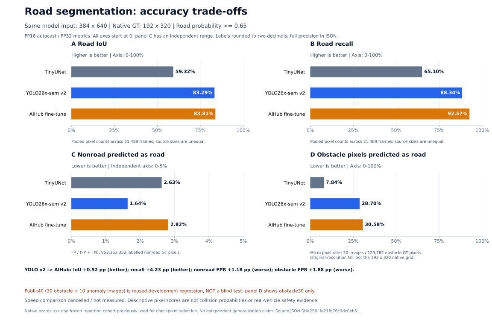

# camera-rc-training

카메라 기반 도로 영역 분할, 데이터 검증, 추가 학습의 회귀 분석과 오프라인 RC 소프트웨어 연구를 위한 공개 코드입니다. **현재 결과는 도로를 더 많이 인식하는 대신 비도로·장애물을 도로로 오인하는 문제가 커졌음을 보여 줍니다.** 개선한 부분과 악화한 부분을 모두 기록하고, 확인된 라벨 문제를 별도 버전으로 보정했습니다.

> **English scope:** Offline camera-road segmentation research with provenance-aware data preparation, fixed evaluation contracts, regression analysis and dry-run control fixtures. Source code is AGPL-3.0-only. No datasets, labels, pretrained or trained weights are distributed. Results are mixed: road recall improved while false-road and obstacle errors regressed. Speed comparison was canceled. Corrected-label candidate results are pending. This is not a validated autonomous-driving product.

## 현재 공개 범위와 상태

| 항목 | 상태 |
|---|---|
| TinyUNet / YOLO v2 / AI Hub 추가 학습 비교 | 고정 공식 계약에서 3개 모델 × 2개 입력 크기 정확도 평가 완료 |
| AI Hub 추가 학습 | 실제 CUDA 3 epoch 완료; 배치 8, 총 14,199 batch |
| 데이터 품질 분석 | 잘못된 다각형, 누락된 비도로 감독, ignore 비중, 야간 라벨 부족, 출처별 회귀 확인 |
| CPU 전처리 보정 | 37,864장 풀 재분할, 84프레임 재처리 중 83프레임의 137,436픽셀 수정 완료 |
| 보정 라벨 후보 | CUDA 3 epoch 완료, 12,462 batch·3,161회 성공 업데이트; 개발셋 채택 기준 미통과; 공식 비교 평가는 진행 중 |
| ACDC 추가 자료 | 학습 1,600 / 검증 406장 다운로드·전처리·독립 검증 완료; 현재 모델 학습/성능표에는 미포함 |
| 이번 전후 처리 속도 비교 | 사용자 요청으로 취소; 속도 개선률 없음 |
| 실제 차량·80km/h·MSI 4/8GB 운용 | 미검증, 자동 모델 교체 없음 |

설치나 테스트는 학습 대기열, 자동화, 웹 서버, 카메라/serial 제어를 시작하지 않습니다. 실행 기능은 명시적으로 호출할 때만 작동합니다. 기본 운용 예제는 dry-run입니다.

## 핵심 결과: 좋아진 점과 악화한 점

기존 YOLO26x-sem v2와 AI Hub 추가 학습 모델을 같은 영상·GT·임계값 **0.65**·분모로 비교했습니다. 아래 입력 크기는 **높이×너비**입니다. 일반 검증은 21,489장, 별도 public 장애물 평가 30장입니다. 전체 값은 픽셀 합산값입니다.

| 입력 | 지표 | 기존 YOLO v2 | AI Hub 추가 학습 | 변화 |
|---|---|---:|---:|---:|
| 192×320 | 도로 IoU ↑ | 73.7804% | 78.9494% | +5.1690pp |
| 192×320 | 도로 recall ↑ | 75.8606% | 86.3692% | +10.5086pp |
| 192×320 | 비도로→도로 FPR ↓ | 0.7604% | 2.5346% | **+1.7742pp 악화** |
| 192×320 | public 장애물→도로 ↓ | 34.6119% | 41.0404% | **+6.4285pp 악화** |
| 384×640 | 도로 IoU ↑ | 83.2851% | 83.8095% | +0.5245pp |
| 384×640 | 도로 recall ↑ | 88.3411% | 92.5724% | +4.2313pp |
| 384×640 | 비도로→도로 FPR ↓ | 1.6372% | 2.8198% | **+1.1826pp, 상대 +72.23% 악화** |
| 384×640 | public 장애물→도로 ↓ | 28.6974% | 30.5751% | **+1.8778pp, 상대 +6.54% 악화** |

`pp`는 퍼센트포인트입니다. 일반 FPR은 GT 비도로 픽셀 중 도로로 예측한 비율이며, 객체 누락률이나 충돌 확률이 아닙니다. 도로 recall이 증가하면서 precision은 384×640에서 93.5700→89.8516%로 낮아졌습니다.



그림은 공개 집계 JSON에서 재생성합니다. 모든 축은 0에서 시작하며 일반 비도로 오인율 패널만 별도 범위를 사용합니다. 장애물 패널은 원본 해상도 정답을 사용하는 공개 장애물 30장으로, 일반 검증 21,489장의 정답 격자와 구분합니다.

전체 IoU만 보면 중요한 회귀가 가려집니다. 384×640에서 **AI Hub 출처 IoU는 65.8279→96.0027%**, **기존 4개 출처 합산은 85.0139→82.6446%**입니다. VKITTI/KITTI Road에서 특히 비도로 오인이 증가했습니다. public 장애물의 표시 픽셀 전부를 도로로 판단한 이미지도 11→15장으로 늘었습니다. 이 결과에 따라 추가 학습 모델을 운용 개선 모델로 승인하지 않았습니다.

세 모델 전체 비교, 출처별·주야간·이미지별 회귀, 실제 업데이트 수와 근거 SHA256은 **[RESULTS](docs/RESULTS.md)**에 있습니다. 이 표는 보정 전 완료 모델의 결과입니다. 이후 데이터 수정으로 성능이 개선되었다고 미리 주장하지 않습니다.

## 데이터에서 발견한 문제와 완료한 조치

이번 실험은 사용자가 선택한 AI Hub **44개 ZIP 스냅샷**을 사용했습니다. 전체 AI Hub 다운로드 완료를 뜻하지 않습니다. 원본 ZIP의 CRC/SHA, 전체 이미지 해독, 클립 분리와 바이트/RGB 중복을 검사하고 고정한 집합입니다.

1. **다각형 오류:** 21,571프레임 중 272프레임(학습 245/검증 27)을 annotation SHA와 사유를 기록해 격리했습니다. 유효 AI Hub 학습 18,932/검증 2,367장만 준비했습니다.
2. **명시적 비도로 주석 누락:** `trafficDrum`, `warningTriangle`이 기존 매핑에서 `ignore255`였습니다. 원본 학습 표본을 확인한 뒤 343개 대상 다각형을 재처리했습니다. 실제 수정은 83프레임, 137,436픽셀의 **255→1**이며 기존 road 픽셀과 공식 평가 정답은 유지했습니다. 재처리한 84프레임 중 한 프레임은 이미 nonroad여서 변경이 없습니다.
3. **부분 주석과 학습 분포 변화:** AI Hub의 무시 영역은 출처/분할별 약 72–80%였습니다. replay 표본도 기존 전체 풀과 구성비가 달라졌습니다. 유효 감독의 분포 변화가 회귀의 원인일 가능성을 분석했으며, 인과관계가 확정된 것은 아닙니다.
4. **야간 장애물 라벨 부족:** 야간 공식 검증 785장에 보행자·자전거·오토바이·라이더·콘 주석이 없습니다. 높은 야간 도로 IoU만으로 이 장애물들의 야간 성능을 입증할 수 없습니다.
5. **개발 분할 고정:** 기존 학습 풀 37,864장을 클립/장치·날짜/scene 단위로 묶어 train 33,228 / dev 4,636으로 분리했습니다. 이 풀은 부모 모델이 본 자료이므로 dev를 블라인드 평가라고 부르지 않습니다.

전처리는 원본과 실패 산출물을 보존하고 새 manifest 및 필요한 수정 mask만 생성했습니다. 독립 검증기는 완료 표시, 모든 관련 해시, 정확한 분할, byte/RGB/group 겹침, 실제 mask diff와 픽셀 수를 검사합니다. 공식/public 현재 이미지를 다시 해독한 것이 아니라 **고정 계약 기록 기준**으로 교차 검사한 범위입니다. [DATASETS](docs/DATASETS.md)에 세부 통계와 한계가 있습니다.

## 빠른 시작: CPU 코드 검증

Python 3.13용 고정 프로필 예입니다. 저장소를 내려받아 루트로 이동한 뒤 실행합니다. CUDA 학습이나 데이터 다운로드는 하지 않습니다.

```bash
git clone https://github.com/charater1024-lang/camera-rc-training.git
cd camera-rc-training
python3.13 -m venv .venv
source .venv/bin/activate
python -m pip install torch==2.9.1 torchvision==0.24.1 --index-url https://download.pytorch.org/whl/cpu
python -m pip install -e '.[test]' -c constraints/cpu.txt
python -m pip check
python -m camera_rc --help
python -c "from pathlib import Path; Path('runs').mkdir(exist_ok=True)"
python -m pytest tests integrations/bevformer/test_run.py -q -p no:cacheprovider --basetemp=runs/cpu-check-001
```

Windows PowerShell에서는 `py -3.13 -m venv .venv` 후 `python` 대신 `.\.venv\Scripts\python.exe`를 사용하면 활성화 스크립트나 실행 정책 변경 없이 실행할 수 있습니다. pytest의 `--basetemp`는 매번 새 디렉터리를 지정하고 기존 데이터/실험 폴더를 넣지 않습니다.

CPU 테스트는 합성 fixture, mock과 작은 CPU 모델로 데이터 처리와 실패 경로를 확인합니다. 실제 모델 정확도나 차량 안전 검증은 아닙니다. GitHub Actions는 CPU wheel과 `.[test]`만 설치하며 dataset/weight 다운로드나 GPU를 사용하지 않습니다. 의존성 설치에는 패키지 레지스트리 접근이 필요합니다. Ubuntu/Python 3.13의 새 환경에서도 [검증한 commit의 Actions](https://github.com/charater1024-lang/camera-rc-training/actions/runs/39883338625)가 통과했습니다: **1,561개 통과·2개 생략**, CPU wheel·CLI·의존성 검사 포함. Linux에서는 optional Ultralytics 통합 1개와 Windows 전용 rename 검사 1개를 생략했습니다. Windows 검사와는 설치 의존성·플랫폼 조건이 다릅니다. 이후 commit의 상태는 해당 Actions 결과로 확인합니다.

2026-10-23 로컬 Windows 검사에서는 `tests/`와 BEVFormer wrapper를 합해 **1,551개 통과·1개 생략**을 확인했습니다. 실제 AI Hub best를 이용한 별도 CPU 1프레임 검사에서도 새 인식 어댑터와 기존 평가기의 확률 최대 차이와 마스크 불일치가 모두 0이었습니다. 이는 해당 입력에서의 구현 일치 검사이며 추가 정확도·속도·실차 검증이 아닙니다. [소프트웨어 검사 집계](reports/software_validation.json), [어댑터 검사 집계](reports/runtime_adapter_cpu_parity.json)

설치 환경, 전체 PowerShell 예, optional extras, 체크포인트 검증과 실제 학습/평가 인터페이스는 **[REPRODUCIBILITY](docs/REPRODUCIBILITY.md)**에 있습니다. `requirements-tested.txt`는 과거 Windows CUDA 환경 관측값이며 모든 플랫폼에서 검증된 lockfile이 아닙니다.

## CPU 전처리만 수행하려면

적법하게 취득한 자료와 검증된 export, quarantine ledger, 고정 평가 계약이 먼저 있어야 합니다. 자신의 파일 경로와 SHA256을 넣은 local policy를 작성한 뒤 새 출력 폴더를 지정합니다.

```bash
python scripts/preprocess_aihub_revision.py --policy configs/local/preprocess.json --output data/my_preprocessed_v1 --workers 4
python scripts/verify_aihub_preprocessing.py --revision data/my_preprocessed_v1 --expected-contract-sha256 ACTUAL_FROZEN_CONTRACT_SHA256
```

위 해시 자리표시자는 실행 전 보존한 자신의 계약 해시로 바꿉니다. [정책 JSON 예제](docs/REPRODUCIBILITY.md#5-보정-전처리만-실행)와 각 script의 `--help`를 확인하십시오. 원본·기존 mask를 수정하지 않으며 model/GPU inference는 수행하지 않습니다. 표본 수·계약·rasterizer가 다른 자료에 과거 실험 해시를 그대로 적용할 수 없습니다.

주의할 실행 구분: `run_aihub_cpu_preparation.py`는 CPU 준비 후 **GPU runner까지 연결**하는 도구입니다. CPU 전처리만 원하는 경우 실행하지 않습니다. 큐/학습/벤치마크 script는 단순 상태 조회 명령과 구분해 명시적으로 호출해야 합니다.

## 선택적 모델 학습과 self-feedback

native semantic 경로는 **Ultralytics 8.4.182**의 semantic API에 맞췄습니다. detection 또는 instance segmentation과 구분합니다. 선택 설치는 `.[semantic]`, CUDA 12.6 실험 프로필은 `constraints/semantic-cu126.txt`입니다. 공식 초기 모델 `yolo26x-sem.pt`와 AMP 보조 `yolo26n.pt`는 별도 취득하고 SHA256을 검사해야 합니다. 파일·출처·기대 해시는 [가중치 준비](docs/REPRODUCIBILITY.md#3-가중치-취득과-검증)에 있습니다.

완료 모델에서 이어 학습할 때는 검증된 `--init-training-report`를 함께 제공해 부모 계보를 유지합니다. 새 optimizer로 시작하는 추가 학습이며 중단 epoch 자동 재개와 다릅니다. 기존의 완료 실행을 반복하거나 실패 폴더를 덮어쓰지 않습니다. GPU 메모리 제한은 PyTorch 할당기 상한으로, 다른 앱의 메모리를 제한하거나 예약하지 않습니다.

이번 self-feedback은 다음과 같이 제한합니다.

- 공식 보고셋·public 40장을 학습, 임계값 조정, 학습 사례 선택에 사용하지 않습니다.
- 학습/개발 자료에서 확인한 가설과 변경 요소를 사전 기록하고 새 폴더에서 최대 후보 1개·최대 3 epoch의 제한된 실험을 평가합니다.
- 부모 노출이 있는 개발 자료는 연구용 선택 계약으로 표시하며 공식 평가기의 계보 검사를 완화하지 않습니다.
- 도로 오인을 줄이면서 recall이 붕괴하는지 함께 확인합니다. 계획된 출처별 조건은 FPR 비증가, 도로 IoU/recall 각각 최대 1pp 하락입니다.
- 결과가 없는 후보는 pending으로 유지합니다. 실패·악화도 보고하고 실제 차량 모델은 자동 교체하지 않습니다.

보정 후보는 CUDA 3epoch를 완료했습니다. 총 12,462batch에서 optimizer 시도 3,165회 중 3,161회가 성공했고 AMP skip은 4회였습니다. 이는 학습 실행 기록이며 최종 정확도가 아닙니다. [후보 학습 집계와 해시](reports/corrected_candidate_training.json)를 공개하고, 완료된 개발/공식 비교 결과만 성능표에 추가합니다. 보정 후보의 새 정확도는 아직 위 표에 포함되지 않았습니다. 개발 4,636장 비교에서는 BDD IoU −1.7539pp·recall −2.5986pp, AI Hub 주간 고속도로/VKITTI의 FPR 증가로 사전 채택 기준을 통과하지 못했습니다. [개발 비교 집계](reports/corrected_development_comparison.json)는 공식 보고셋 결과와 구분합니다. ACDC 2,006쌍 준비와 독립 검증도 완료했습니다. 후속 검사에서 기존 train/dev 37,864장·공식 21,489장·public 40장의 고정 기록과 바이트/RGB 중복 0건을 확인했습니다. 기존 이미지를 재해독하거나 유사 장면까지 검사한 것은 아닙니다. [교차 감사](reports/acdc_cross_source_audit.json)를 별도 보존하며, ACDC는 현재 후보에 섞지 않아 학습 효과를 주장하지 않습니다.

## 주간과 야간 모델을 나눠야 하나요?

현재 근거는 **공통 모델의 라벨·조건별 coverage 개선을 먼저 검증**하는 쪽을 지지합니다. 두 모델의 우위를 직접 비교한 우리 실험은 아직 없습니다. 별도 모델은 황혼, 터널, 역광과 혼합 조명에서 선택 오류·전환 지연·메모리 비용을 추가할 수 있습니다. 작은 조건별 어댑터나 증류 역시 검증할 연구 방향이며 이미 더 우수하다는 결과가 아닙니다.

야간 도로 주석은 많아도 장애물 주석은 매우 부족합니다. 데이터가 없는 상태에서 모델만 둘로 나누면 평가 공백이 해결되지 않습니다. 문헌, 반례, 대응 데이터와 비교 설계는 [주야간 인식 연구 메모](docs/DAY_NIGHT_PERCEPTION_RESEARCH.ko.md), 현재 적용 범위는 [LIMITATIONS](docs/LIMITATIONS.md)에 있습니다.

이번에 확인한 데이터 문제, 추가 ACDC의 선택 근거, 모델 대안별 채택 조건은 [최신 개선 검토](docs/IMPROVEMENT_REVIEW.md)에 정리했습니다. [전처리 집계](reports/preprocessing_audit.json)와 [ACDC 학습 라벨 빈도](reports/acdc_training_label_coverage.json), [완료한 ACDC 준비 검증](reports/acdc_preparation.json)은 원본 파일 없이 공개하는 감사 근거입니다.

## 코드 구성

| 경로 | 역할 |
|---|---|
| `src/camera_rc/` | 데이터 manifest, baseline 학습/평가, 오프라인 계획·제어·센서 회귀 |
| `scripts/prepare_*.py`, `audit_*.py`, `verify_*.py` | 출처별 변환, 고정·중복·라벨·출처 검사 |
| `scripts/preprocess_aihub_revision.py` | 원본을 보존하는 CPU label revision |
| `scripts/train_yolo_semantic.py` | 검증된 초기화/계보를 사용하는 CUDA semantic 학습 |
| `scripts/evaluation_contract.py`, `evaluate_frozen_road.py` | 학습 출처와 분리한 고정 보고용 평가 계약 |
| `scripts/review_aihub_feedback.py` | 완료 보고서 집계·회귀 검토; 자체 학습/배포를 하지 않음 |
| `scripts/serve_aihub_progress.py`, `assets/aihub_progress.html` | 로컬 읽기 전용 진행 화면; 자동 시작 없음 |
| `configs/` | 공개 예제 설정; 실제 파일·해시·장치 설정은 제외된 `configs/local/`에서 관리 |
| `tests/` | 합성/모의 CPU 소프트웨어 회귀 검사 |
| `integrations/bevformer/` | 별도 upstream checkout/env를 사용하는 연구 wrapper |
| `deploy/` | 명시적 설치가 필요한 dry-run 서비스/하드웨어 참고 파일 |
| `docs/` | 현재 결과/재현 문서 및 별도 표시한 과거 실험·연구 설계 |

현재 해석의 기준 문서는 [RESULTS](docs/RESULTS.md), [DATASETS](docs/DATASETS.md), [REPRODUCIBILITY](docs/REPRODUCIBILITY.md), [LIMITATIONS](docs/LIMITATIONS.md)입니다. 그 외 문서는 상단에 역사적 기록 또는 연구 설계로 표시했습니다. 과거 속도값·진행 중 상태·미실행 제안이 현재 완료 상태를 뜻하지 않습니다.

## 운용·보안 한계

도로 mask는 차량이 통행해도 된다는 정답이 아닙니다. 카메라 보정, 거리/가림, 물체 추적, 시간 동기화, 운용 환경, 실제 제동·비상 정지가 별도로 필요합니다. 이진 pixel 지표로 작은 물체 instance 누락률이나 충돌 확률을 추론하지 않습니다. 3080 Laptop의 할당기 3/5/7GiB 제한은 실제 MSI 4/8GB 성능 측정이 아닙니다. 80km/h 인지·제동·무사고는 검증하지 않았습니다.

체크포인트는 신뢰하는 출처의 파일만 로드하고 hash를 확인하십시오. 진행 서버는 localhost 전용이며 인터넷 공개용 인증 서비스가 아닙니다. 민감한 원본 경로와 데이터를 공개 issue/log에 붙이지 않습니다. 자세한 경계와 보고 방법은 [SECURITY](SECURITY.md)에 있습니다.

## 라이선스와 데이터 출처

원본 코드·문서는 **AGPL-3.0-only**입니다. [LICENSE](LICENSE)는 GNU 공식 원문 전체이며, [THIRD_PARTY_NOTICES](THIRD_PARTY_NOTICES.md)는 의존성과 외부 코드/자료를 구분합니다. AGPL 코드 라이선스는 데이터·모델 이용 권리를 부여하지 않습니다.

AI Hub·BDD100K·Virtual KITTI 2·CamVid·KITTI·RoadObstacle21/RoadAnomaly21 자료와 파생 mask, 원본 ZIP, pretrained/trained weights는 재배포하지 않습니다. 특히 Virtual KITTI 2의 비상업 조건 등 원 제공자 조건을 별도로 확인해야 합니다. 공개된 것은 어댑터·검증 코드·집계 통계·해시이며, 자료는 [DATASETS](docs/DATASETS.md)의 공식 경로에서 직접 취득합니다.

기여 시 synthetic fixture로 회귀를 설명하고 데이터/모델/개인 경로를 추가하지 마십시오. 수치를 변경할 때는 완료한 보고서의 protocol·분모·hash와 개선/악화 양쪽을 명시합니다. 새로운 논문 아이디어나 구조 제안은 직접 측정한 결과와 분리합니다.
