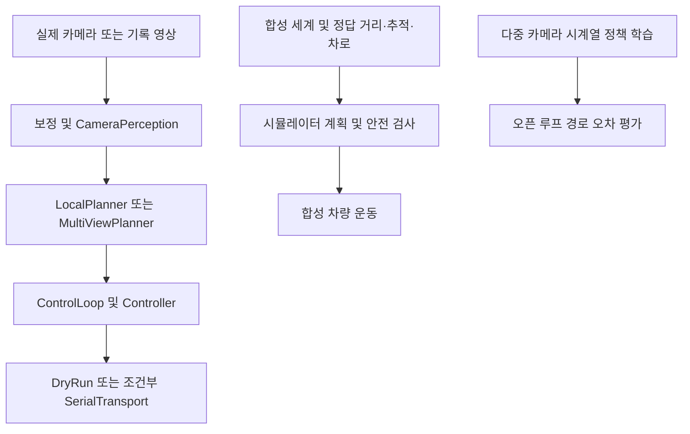

# 자율주행 모델·코드 구조 검토

검토일: 2026-10-24

대상: `camera-rc-training` 프로젝트 루트

기준 커밋: `e0c5f80bb71977096ce79fe94c20330eeb7dd6c3` 및 현재 미커밋 변경

## 결론

현재 프로젝트는 인식 모델 학습, 제한된 환경의 저속 RC 주행 파이프라인, 합성 시뮬레이터를 연구하는 기반이다. 일반 도로 자율주행 자동차에 필요한 인식·위치 추정·행동 계획·독립 안전 검증이 하나의 검증된 실행 경로로 연결되어 있지는 않다. 모델 크기를 늘리기보다 실행 경로와 데이터 계약을 먼저 보완해야 한다.

현재 설정은 실제 차량 출력에 제한을 두고 있다. 아래 P1은 그 제한을 해제하거나 새 모델을 연결하기 전에 해결해야 하는 문제라는 뜻이며, 현재 실제 차량에서 사고가 재현되었다는 뜻은 아니다.

## 현재 구조

시뮬레이터 안전 검사와 학습된 시계열 정책은 현재 카메라 실행 경로에 같은 방식으로 연결되어 있지 않다.

| 구성 | 구현된 내용 | 적용 범위 및 부족한 점 |
|---|---|---|
| TinyUNet | 분할 및 양수 깊이 출력 모델 구성 | 깊이 모델 코드가 있다는 사실과 검증된 실시간 미터 거리 인지는 다르다. 실행 경로는 분할 중심이다. |
| YOLO semantic 어댑터 | 로컬 체크포인트·보고서 검증 | dry-run/replay 제한. 실차 제어 검증을 대신하지 않는다. |
| 선택적 객체 검출기 | 2D 박스·분류·점수 | 실제 객체 거리·속도·추적·불확실성 생산 체인이 부족하다. |
| TinyTrajectory | 단일 영상과 차량 상태로 미래 좌표·속도 예측 | 시간에 따른 객체 움직임이나 물리적 실행 가능성을 보장하지 않는다. |
| JointCameraTemporalPolicy | 공유 인코더, 카메라 광선·위치·시간 임베딩, attention, 미래 경로 | 카메라 기하와 시간 정보는 구현되어 있다. 실행 경로 연결 및 폐루프 안전 검증이 부족하다. |
| 차선 학습 준비 | ego_lane_v1 라벨·준비 도구 | 미학습 상태. 시뮬레이터 차선 유지를 영상 기반 차선 모델 성능으로 볼 수 없다. |
| 제어 및 출력 제한 | 계획 만료, 고장 latch, PI 속도 제어, 조향 제어, 출력 허용 조건 | 실측 제동·조향·MCU 펌웨어 검증은 별도로 필요하다. |

## 우선순위별 발견 사항

### 1. P1 — 시뮬레이터 안전 검사가 실제 카메라 실행 경로에 연결되지 않음

근거: `src/camera_rc/driving/pipeline.py:58`, `src/camera_rc/driving/runtime.py:104`, `src/camera_rc/simulator/engine.py:271`, `:796`, `:814`.

DrivingPipeline은 인식 결과를 로컬 계획기로 보내고, ControlLoop는 고장·시간 만료 검사 후 Controller에 계획을 전달한다. 시뮬레이터의 ShadowSafetySupervisor, 역주행·차선 경계 거부, 신호 정지는 이 경로에 없다. 기존 Controller의 검사를 부정하는 지적이 아니라 두 경로의 안전 보장이 다르다는 지적이다.

영향: 시뮬레이터에서 차선 이탈이나 신호 위반을 막았다고 해서 실제 영상 실행에서도 동일하게 막는다고 판단할 수 없다.

보완: simulator/replay/live가 공통의 시간·좌표·단위·상태 계약을 가진 관측 정보를 생산하고, 동일한 안전 승인 경계를 통과하도록 구성한다. 실제 관측 정보가 없거나 오래되면 통과시키지 않아야 한다. 합성 정답을 실제 센서 정보인 것처럼 전달하는 연결은 해결책이 아니다.

완료 기준: 같은 위험 장면의 replay와 simulator가 같은 거부 사유를 내며, 정보 누락·지연·추적 소실에서도 명령이 안전 상태로 전환된다.

### 2. P1 — 라벨 의미가 반대인 모델도 기본 실행 설정과 결합될 수 있음

근거: `src/camera_rc/lane_training.py:19-20`, `configs/lane_segmentation.json`, `src/camera_rc/driving/config.py:13`, `src/camera_rc/driving/perception.py:59-87`.

차선 라벨은 `0=주석된 자기 차선 밖`, `1=자기 차선`, `255=미관측 또는 미주석`이다. 반면 실행 설정은 기본적으로 `drivable_class_ids=[0]`을 쓴다. native 체크포인트 로더는 task, 형상, 값의 유한성, 클래스 번호 범위 등을 검사하지만 `label_space_id`와 클래스 의미 일치는 확인하지 않는다.

영향: 향후 학습된 2클래스 차선 체크포인트를 기존 기본 설정에 연결하면, 다른 로드 조건을 만족하는 경우 차선 밖 클래스가 주행 가능 확률에 포함될 수 있다. 현재 차선 모델을 실행해 재현한 결과가 아니라 소스에서 확인한 의미 계약 누락이다.

보완: 실행 설정에 기대하는 라벨 공간과 의미 매핑을 명시하고, 체크포인트의 라벨 공간·클래스 매핑과 정확하게 대조한다. 도로 표면과 자기 차선 출력을 구분한다. 기본 클래스 번호를 바꾸는 것만으로는 다른 모델의 역전 위험이 남는다.

완료 기준: road_surface_v1과 ego_lane_v1을 교차 연결하면 추론 시작 전에 거부되며, 각각 올바른 클래스만 주행 가능 영역으로 변환된다.

### 3. P1 — 실제 거리·추적·위치 추정 대신 합성 정답에 의존하는 부분이 큼

근거: `src/camera_rc/simulator/engine.py:960`, `:1022`, `src/camera_rc/driving/types.py:7`, `:14`, `:30`, `src/camera_rc/driving/perception.py:91`, `:107`.

시뮬레이터는 oracle_range/oracle_tracks를 표시하며 객체 표시는 learned_detector_loaded=False다. 실제 인식 인터페이스의 Detection은 2D 박스·점수·라벨이고, VehicleState에는 전역/지도 좌표 위치 및 공분산이 없다. 검출 체크포인트는 선택 사항이므로 검출기가 없는 경우도 빈 객체 목록이 된다. 관측된 객체 없음과 검출기 미구동을 인터페이스에서 분명하게 구분할 필요가 있다.

영향: 보행자와 자동차가 화면에서 움직여도 실제 영상에서 객체를 발견하고 속도·거리·차로 관계를 추정하는 능력이 검증된 것은 아니다. 추적 소실과 가려짐을 자유 공간으로 오인할 수 있다.

보완: 검출 상태, 추적 ID·속도·불확실성, 미터 단위 거리 및 자기 위치·자세를 실제 관측으로 생산한다. 센서 구성은 제한된 운행 조건과 측정 가능한 오차에 따라 선택한다. 특정 센서나 특정 대형 모델 도입 자체를 완료 기준으로 삼지 않는다.

### 4. P1 — 산지·고속 주행을 검증할 수 있는 기하·차량 모델이 아님

근거: `src/camera_rc/driving/geometry.py:1-6`, `src/camera_rc/driving/planner.py:98`, `src/camera_rc/simulator/terrain.py:158`, `src/camera_rc/simulator/engine.py:1019`.

실행 경로의 미터 변환은 보정된 고정 자세와 평면 노면을 가정하는 homography다. 객체 박스 아래쪽을 지면에 투영한다. 경사·요철·카메라 피치 변화·지면에 닿지 않는 물체에서는 이 가정이 깨진다. 지역 지형 시뮬레이터 역시 2D 운동학 자전거 모델에 종방향 경사 항을 더한 것으로, 타이어·현가장치·노면 접촉·수직 가림을 풀지 않는다.

영향: 강원 산지 화면과 150 km/h 속도 설정은 산악 도로 또는 해당 속도의 인지·안정성 검증을 뜻하지 않는다. RC 차량의 크기·제어 설정을 승용차에 그대로 적용할 수도 없다.

보완: 제한된 평탄 저속 환경의 기준선을 유지하면서 실제 거리 오차, 제동 거리, 조향 지연, 노면 마찰과 자세 변화의 영향을 측정한다. 고속·산지 범위는 별도 동역학 및 센서 검증이 갖춰진 뒤 확장한다.

### 5. P2 — 도시 주행 행동 계획과 도로 연결 정보가 부족함

근거: `src/camera_rc/driving/planner.py:23`, `:132-169`, `src/camera_rc/simulator/lane.py:213`.

LocalPlanner는 기본 2 m 전망 범위의 저속 RC용 후보 곡률 계획기이며, route_hint는 straight/left/right/stop이다. 전역 경로, 차로 연결, 우선권, 교차로 진입, 실제 신호 인지, 차선 변경 및 보행자 행동 예측을 통합한 행동 계획기는 아니다. 합성 차로와 시간표 신호 규칙은 유용한 시나리오 기능이지만 일반 도시 운행 기능으로 일반화할 수 없다.

보완: 목적지 경로 → 도로 규칙과 객체 예측을 이용한 행동 결정 → 시간에 따른 지역 궤적 → 안전 검사 순으로 책임과 입력을 구분한다. 차로 ID·방향·연결·정지선 및 관측 신뢰도를 데이터 계약에 포함한다.

### 6. P2 — 시계열 모델이 있어도 학습 목표와 평가가 주행 안전을 포괄하지 않음

근거: `src/camera_rc/models.py:30`, `:51`, `src/camera_rc/joint_policy/model.py:48`, `:162-198`, `src/camera_rc/joint_policy/training.py:118-155`, `:230`.

JointCameraTemporalPolicy는 카메라 기하·시간 정보를 사용하는 시계열 모델이다. 다만 출력은 미래 x/y/속도이며 좌표에는 물리 제약이 없고 속도에는 softplus가 적용된다. 학습의 SmoothL1 경로 손실과 ADE/FDE·속도 오차 평가는 충돌, 교통 규칙, 대체 가능한 안전 경로, 폐루프 복구를 직접 검증하지 않는다. 평가 결과에도 open_loop_only=True, collision_rate_measured=False가 명시되어 있다. 현재 DrivingPipeline은 이 정책 모델을 사용하지 않는다.

보완: 먼저 기록 데이터에서 시간 정렬·미래 정보 누출·분할 독립성을 검증하고, 이후 폐루프에서 충돌·규칙·진행률·불필요한 정지·복구를 함께 평가한다. 모델의 경로 제안을 최종 출력으로 간주하지 말고 차량 제약과 독립 안전 검사를 적용한다. BEV나 특정 네트워크로 교체해야만 한다는 결론은 아니다.

### 7. P2 — 촬영 시각·제어 지연·하드웨어 안전 계약의 실측이 필요함

근거: `src/camera_rc/driving/sources.py:52`, `src/camera_rc/driving/multisource.py`, `src/camera_rc/driving/control.py:124`, `src/camera_rc/driving/mcu_reference.py:1-6`.

카메라 timestamp는 read 이후 호스트 수신 시각이다. 수신 시각 차이가 작아도 실제 노출 시각이나 USB 버퍼 지연이 같다는 보장은 없다. 다중 뷰 추론은 순차 실행이다. 제어 프로토콜에는 실제 조향각 encoder가 없고 MCU 코드는 Python 실행 참조이며 GPIO 펌웨어가 아니다.

보완: 노출 시각·최대 지연·시계 오차·운동 보상, 실제 조향·제동 응답을 측정한다. 호스트 정지에도 독립적으로 작동하는 MCU watchdog·비상 정지·통신 장애 대응을 하드웨어 결합 시험으로 검증한다. 기존 50 Hz Python 제어 루프만으로 최악 응답 시간을 보장할 수 없다.

### 8. P2 — 검증 자료를 실제 운행 허용 조건과 결합해야 함

근거: `docs/RESULTS.md`, `docs/LIMITATIONS.md`, `src/camera_rc/driving/config.py:165`, `src/camera_rc/joint_policy/training.py:152`.

분할 IoU, 일부 공개 영상 회귀 검사, 합성 시나리오 통과는 각 범위에서 의미가 있다. 그러나 독립된 미사용 시험 장면, 야간·우천·가림·작은 보행자·차로 합류·지연 등의 성능과 실제 제동 결과를 대신하지 않는다. models_validated_for_control 같은 설정값은 사람이 설정하는 선언이며 검증 보고서와 자동 결합된 증거가 아니다.

보완: 운행 설계 영역(ODD: 도로·지역·속도·환경 조건)을 먼저 명시하고, 그 범위의 독립 시험과 범위 이탈 시 안전 전환을 검증한다. 체크포인트·보정·차량 설정·코드 버전에 보고서 해시를 결합하고 조건이 달라지면 승인을 무효화한다.

## 유지할 장점

- serial 설정과 명시적 --actuate를 함께 요구하며, YOLO semantic은 실차 출력이 차단되어 있다.
- 진단용 모델·합성 보정·미관측 영역의 임의 자유 공간 가정을 제한한다.
- 계획 만료·미래 timestamp·일부 통신 고장을 제어 경계에서 검사하고 고장을 latch한다.
- shadow 안전 검사와 MCU 프로토콜 참조가 있어 향후 공통 안전 계약을 검증할 기반이 있다.
- 합성 정답, 미검증 사항, 오픈 루프 평가 한계가 여러 코드와 결과에 명시되어 있다.

## 권장 작업 순서

1. 라벨 의미 계약과 검출기 상태 계약을 보완하고 잘못된 모델 연결이 시작 단계에서 차단되도록 검사한다.
2. simulator/replay/live의 관측·안전 승인 인터페이스를 통합한다. 실제 관측이 없는 기능은 미지원 상태로 남긴다.
3. 실제 기록 영상으로 차선·검출·미터 거리·추적·위치 추정의 오차와 지연을 평가한다.
4. 제한된 저속 ODD에서 폐루프 시나리오와 하드웨어 결합 시험을 통과한 뒤 운행 범위를 단계적으로 확장한다.

새로운 학습 실행이나 대형 모델 교체는 위 계약 문제의 해결을 대신할 수 없다. 이번 검토에서는 모델 학습, 모델 자동 채택, 실제 차량 출력을 시작하지 않았다.

## 수행한 검사와 한계

기존 하드웨어 독립 검사 175개 통과:

- tests/test_runtime_contract.py
- tests/test_shadow_safety.py
- tests/test_mcu_reference.py
- tests/test_planner.py

이 검사는 실행 계약·안전 규칙·MCU 참조·계획기의 기존 동작을 확인한다. 실제 카메라/GPU 추론, 학습 체크포인트 로딩, serial 출력, 물리 차량 및 고속 주행은 시험하지 않았다. 특히 라벨 의미 문제는 정적 소스 검토 결과이며 실제 학습된 차선 체크포인트를 로드해 재현한 결과가 아니다. 기존 검사 통과는 위의 누락 기능이 구현되었다는 의미가 아니다.

## 구조 판단에 참고한 공식 자료

- Autoware의 sensing/localization/perception/planning/control/vehicle interface 구분: https://autoware.org/autoware-overview/
- NHTSA Automated Driving Systems 및 ADS 2.0의 ODD·상황 대응·안전 전환 관점: https://www.nhtsa.gov/vehicle-manufacturers/automated-driving-systems

자료는 구조와 검증 범위를 비교하기 위한 참고이며 국내 법규 승인 또는 이 프로젝트의 안전 인증 근거로 사용하지 않았다.
