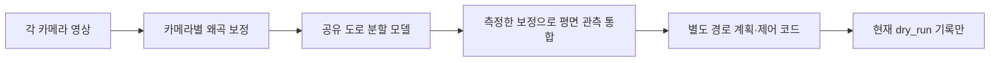

# 8방향 카메라 학습 준비와 현재 한계

> **과거 실험·연구/인터페이스 참고 문서.** 아래 수치와 진행 표현은 문서 작성 당시의 범위입니다. 현재 완료 결과와 취소/미검증 항목은 [RESULTS](RESULTS.md), 재현 절차는 [REPRODUCIBILITY](REPRODUCIBILITY.md), 운용 한계는 [LIMITATIONS](LIMITATIONS.md)를 우선 확인하십시오. 예제 명령은 설치 시 실행되지 않으며 학습·다운로드·서비스·제어의 새 실행을 뜻하지 않습니다. 로컬 경로는 이 공개본에서 프로젝트 상대 예제로 바꿨습니다.

2026-10-21. 카메라 8대는 모든 자율주행 차량에 필요한 고정 수량이 아니다. 필요한 수량과 렌즈는 차량 크기, 장착 높이, 화각, 근거리 사각지대, 주행 범위 및 처리 지연으로 정해야 한다. 이 프로젝트의 8방향 구성은 측정 전 제안이며 테슬라 복제품이나 무사고 보증이 아니다.

## 테슬라의 공개 설명과 이 프로젝트의 차이

카메라 수와 독립 모델 수를 일대일로 대응시키면 안 된다. 테슬라의 [공개 AI 설명](https://www.tesla.com/AI)은 카메라별 인식과 여러 카메라의 연속 영상을 활용한 통합 공간 표현을 설명한다. 더 최근의 [2026년 CVPR 공식 발표 안내](https://www.tesla.com/event/tesla-x-cvpr-2026)는 영상 입력에서 제어 출력까지 학습하는 end-to-end 주행 모델을 설명한다. 이것이 최신 시스템의 모든 구성 요소가 신경망 딱 하나라는 뜻은 아니며, 정확한 내부 모델 개수·현재 가중치 공유 범위를 공개 자료만으로 단정하지 않는다. 과거 발표의 네트워크 수를 현재 버전에 그대로 적용하지 않는다.

현재 프로젝트는 다음 구조다.



모델은 한 번만 메모리에 적재하여 각 영상을 batch1로 순차 처리한다. 모델 메모리는 카메라 수만큼 복제하지 않지만, 프레임 버퍼와 계산량·전체 지연은 늘어난다. 이는 테슬라의 end-to-end 주행 정책을 재현한 구조가 아니다. 현재 도로/비도로 모델은 객체 종류, 신호 상태, 3D 거리, 상대 속도를 학습한 모델도 아니다.

## 제안된 관측 역할

`configs/camera_rig_8_roles.json`과 `configs/runtime_msi_8cam_dryrun.json`은 같은 이름을 사용한다. 아래는 관측 목표이며 현재 모델의 확보된 기능 목록이 아니다.

| ID | 관측 목표 | 실제 차량 자료 |
|---|---|---|
| front_main | 전방 도로·차량·차선 | 아직 없음 |
| front_wide | 넓은 전방·교차로 진입 방향 | 아직 없음 |
| front_near | 차체 바로 앞·낮은 장애물 | 아직 없음 |
| left_forward | 좌측 전방·교차 방향 | 아직 없음 |
| right_forward | 우측 전방·교차 방향 | 아직 없음 |
| left_rearward | 좌측 측후방·접근 차량 | 아직 없음 |
| right_rearward | 우측 측후방·접근 차량 | 아직 없음 |
| rear | 후방·후진 주변 | 아직 없음 |

실제 렌즈·화각·장착 위치·노출 시각·보정 행렬은 정하지 않았다. 프로파일의 카메라 장치와 보정 파일은 교체할 자리이며 실행 가능한 실차 보정값이 아니다. 현재 구현의 pinhole 보정을 fisheye 렌즈에 그대로 적용하면 안 된다.

## 방향과 조건별 학습

`scripts/prepare_camera_role_curriculum.py`는 원본 방향과 조건을 보존하여 하나의 공유 모델을 학습할 설정을 만든다. 각 데이터 소스의 확률 질량을 실제 존재하는 방향에 균등하게, 다시 각 방향의 실제 조건에 균등하게 나눈다. A2D2처럼 전방 중앙 영상이 많은 자료에서 측면·후방의 학습 비중이 묻히는 것을 줄이려는 실험이다. 개선은 검증 결과로 판단한다.

| 자료 | 그대로 유지하는 구분 | 임의로 만들지 않는 정보 |
|---|---|---|
| BDD | 전방, 조건 미분류 | 전방 광각·근거리 렌즈 또는 실차 역할 |
| A2D2 | 원본 6개 카메라 ID | 8대 동기 촬영 묶음, 추정 날씨 |
| Virtual KITTI 2 | 앞 스테레오 0/1, 원본 날씨·시점 변형 | 실제 차량 8방향 관측 |
| ACDC | 전방, 안개·야간·비·눈 | 측후방 영상 |
| 직접 촬영 자료 | 명시한 rig_id·camera_role·condition | 누락된 역할이나 라벨 |

A2D2 예정 train/val 쌍은 전방 중앙27,504/870, 전방 좌측1,074/892, 전방 우측911/886, 측면 좌측908/742, 측면 우측2,034/688, 후방899/795다. 검증은 하나의 주행 장면이며 보류 시험은 전방 중앙만 있다는 한계가 있다. 이것을 각 방향의 충분한 도로 일반화 검증으로 해석하지 않는다.

후속 일회성 큐 `scripts/run_camera_role_queue.py`는 기존 대용량 큐가 학습·평가까지 완료된 다음에만 실행되도록 구성한다. GPU 학습 작업을 동시에 겹치지 않는다. 원본 준비 보고서와 manifest 해시를 이전 학습에 기록된 값과 비교하고, BDD·A2D2·Virtual KITTI·ACDC로 방향/조건별 학습을 준비한다.

기본 후속 실험은 각 소스의 질량1, 1epoch, 32,000회 샘플 추출, 클래스 가중치 도로1/비도로2다. 중복 추출이 가능한 균형 샘플링이므로 32,000회가 서로 다른 32,000장이나 전체 자료 1회 순회를 뜻하지 않는다. 전체 이미지를 사용하는 앞선 대용량 실험과 역할이 다르다. 초기값은 대용량 전체 소스 학습의 체크포인트를 쓰고, 변경 전후 모델을 같은 방향·조건별 검증과 기존 CamVid/KITTI 및 장애물 회귀 자료로 비교한다.

`report.json`의 `all_roles_have_real_rig_train_and_val_samples`는 공개 자료만으로 true가 되지 않는다. `--require-vehicle-coverage`를 사용하면 실제 차량 8역할의 학습·검증 자료가 하나라도 없을 때 준비를 거부한다. 샘플이 있다고 표시되는 것 역시 라벨 품질·캘리브레이션·실차 안전성의 증명이 아니다.

직접 촬영 자료의 한 행은 다음 형식이다. 경로는 실제 파일을 가리켜야 하고, 마스크는 검토한 0=도로/1=비도로/255=무시 ID 영상이어야 한다. 같은 주행의 모든 카메라와 연속 프레임은 같은 split에 둔다. 예시 경로·이름은 학습 자료가 아니다.

```json
{
  "image": "recordings/drive_001/front_near_0001.png",
  "target": "labels/drive_001/front_near_0001.png",
  "task": "segmentation",
  "label_space_id": "road_surface_v1",
  "dataset_id": "my_vehicle",
  "rig_id": "proposed_eight_exterior_cameras_v1",
  "camera_role": "front_near",
  "condition": "day_dry",
  "clip_id": "drive_001",
  "group_id": "drive_001",
  "origin_id": "my_vehicle:drive_001",
  "split": "train"
}
```

이 형식은 카메라별 이미지 사전학습용이다. 동기 비디오 융합 학습을 하려면 별도로 노출 시각, 카메라 내·외부 보정, 차량 자세·속도·조향과 일관된 3D/시간축 정답이 필요하다.

## 운용과 안전성의 범위

8대 설정은 dry_run 전용이며, 현재 코드는 7·8대 구성의 물리 시리얼 출력을 설정 플래그와 관계없이 거부한다. 이는 이번에 확장한 구성의 실차 측정과 검증이 없기 때문이다. 기존 4대 설정을 실차 검증 완료로 인정한다는 뜻은 아니다.

새 테스트는 전체 8방향의 입력, 모델 한 개 공유, 누락된 방향, 오래된 방향의 재사용 방지, 가장 오래된 입력에 따른 계획 만료, 한 방향의 장애물을 다른 방향의 도로 판정이 덮지 않는 동작을 확인한다. 숫자 카메라 인덱스가 실제 V4L2 장치 존재 검사를 건너뛰던 문제도 수정했다.

여전히 확인되지 않은 부분이 있다. 호스트 수신 시각은 실제 노출 시각이 아니고, 드라이버가 같은 영상을 반복하는 고장은 현재 검출하지 못한다. 평면 투영은 경사·입체 장애물·동적 객체의 미래 충돌을 모델링하지 않는다. 192×320 입력에서는 작은 장애물이 사라질 수 있다. 모든 카메라의 잘못된 확신을 단순 다중 카메라 비교가 해결하지도 않는다. MSI 4GB/16GB 장치에서 8개 영상의 실제 USB 대역폭, 디코딩과 전체 지연 역시 아직 측정하지 않았다.

[테슬라 FSD Supervised 공식 안내](https://www.tesla.com/support/fsd)도 운전자 감독을 요구한다. 어떤 카메라 수나 학습 데이터 양도 사고가 절대로 발생하지 않는다는 보장을 제공하지 않는다. 물리 비상 정지·차량 정지 거리·센서 고장 대응·폐쇄 공간 검증은 모델 학습과 별개로 필요하다.

## 이번 실행에서 확인한 결과

2026-10-21 22:09 KST 기준이다. D: 프로젝트에 반영한 전체 테스트는 **701 passed, 1 skipped**이며 로그는 `runs/eight_camera_tests_v2.log`에 있다.

- `runs/verification_eight_role_training_v1/verification.json`: 합성 train 8장/val 8장으로 공유 모델 한 개를 CPU 학습했다. 옵티마이저 4회 적용, 파라미터 텐서 32개 변경, 8역할의 검증 분리 실행을 확인했다. 합성 자료의 높은 점수는 실제 도로 성능이 아니다.
- `runs/verification_eight_camera_runtime_v1/verification.json`: 실제 모델 적재와 8개 합성 뷰의 추론·계획·모의 제어 연결을 확인했다. 물리 출력은 없었고 종료 정지 명령도 기록했다. CPU에서 20개 영상 묶음의 처리 p99는 약646ms였다. CPU 진단에만 완화된 시간 제한을 사용했으며, MSI의 GPU 지연 목표를 통과했다는 뜻은 아니다.
- `runs/camera_role_queue_v1/status.json`: 후속 학습 프로세스를 시작했고, 현재 `waiting_for_upstream_queue`다. 기존 `large_data_queue_v1`는 Virtual KITTI RGB의 검증된 다운로드 완료를 기다리고 있다. A2D2·ACDC 다운로드도 진행 중이며, 후속 실제 공개 자료 학습 결과는 아직 없다.

후속 작업은 현재 PC의 일회성 실행 프로세스다. 재부팅 후 자동으로 다시 시작하는 서비스가 아니므로 전원이나 프로세스가 종료되면 상태와 로그를 확인해야 한다. `runs/camera_role_queue_v1/STOP_REQUESTED`라는 파일을 만들면 이 후속 큐와 그 자식 작업을 중단하며, 별도로 실행 중인 다운로드나 이전 큐까지 중단하지는 않는다. 학습 완료 후에도 모델 자동 배포와 물리 출력 승인은 수행하지 않는다.
