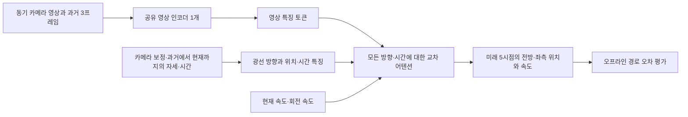

# 여러 카메라와 과거 영상을 함께 학습하는 경로 모델

> **과거 실험·연구/인터페이스 참고 문서.** 아래 수치와 진행 표현은 문서 작성 당시의 범위입니다. 현재 완료 결과와 취소/미검증 항목은 [RESULTS](RESULTS.md), 재현 절차는 [REPRODUCIBILITY](REPRODUCIBILITY.md), 운용 한계는 [LIMITATIONS](LIMITATIONS.md)를 우선 확인하십시오. 예제 명령은 설치 시 실행되지 않으며 학습·다운로드·서비스·제어의 새 실행을 뜻하지 않습니다. 로컬 경로는 이 공개본에서 프로젝트 상대 예제로 바꿨습니다.

2026-10-21. 이 문서는 `.`에 추가한 오프라인 연구용 학습을 설명한다. 카메라별 인식 결과를 따로 합치던 기존 경로와 별개로, 여러 카메라·시간의 영상 특징을 하나의 모델 안에서 함께 처리하여 미래 경로를 학습한다. 테슬라의 비공개 구조를 복제한 모델이나 실차 운행 승인이 아니다.

## 구현한 구조



기본 모델은 학습 가능한 파라미터 **161,779개**다. 공유 `enc1/enc2/enc3`는 기존 TinyUNet 도로 인식 체크포인트에서 호환되는 가중치만 초기화할 수 있다. 새 경로 출력과 어텐션 부분은 새로 학습한다. 8시야 × 3프레임에서는 영상별 3×5 특징을 모은 총360개 토큰을 미래5시점 질의가 함께 처리한다. 모델은 기하 정보를 조건으로 이용하지만, 명시적인 3D 점유 공간이나 깊이 정답을 학습하는 BEV 모델은 아니다.

전체 학습에서 공유 인코더와 경로 출력까지 역전파한다. 현재·과거 영상, 현재 상태와 과거 자세만 입력으로 사용한다. 미래 영상은 거부하고 미래 자세는 경로 정답 생성에만 사용한다. 원래 주행 장면의 날씨·카메라 변형을 같은 split에 두어 학습/검증/시험 중복을 막는다.

테슬라의 [공개 AI 설명](https://www.tesla.com/AI)은 카메라별 인식과 다중 카메라·시간 통합을, [2026년 공식 발표 안내](https://www.tesla.com/event/tesla-x-cvpr-2026)는 영상부터 차량 동작까지의 종단간 학습을 설명한다. 이 프로젝트가 구현한 것은 그중 **영상에서 미래 경로까지 공동 학습하는 작은 실험**이다. 직접 조향·가속 명령의 종단간 학습은 구현하지 않았다.

## 실제 공개 자료 학습의 범위

첫 자료는 [Virtual KITTI 2](https://europe.naverlabs.com/proxy-virtual-worlds-vkitti-2/)다. 실제 도로 영상과 구별되는 시뮬레이터 자료이며, 전방 좌·우 스테레오 두 시야와 카메라 내·외부 파라미터가 있다. 이것을 측후방까지 보는 8대 자료로 복제하지 않는다.

- 과거3프레임 × 전방2시야를 함께 입력한다.
- clone/fog/morning/overcast/rain/sunset의 6조건을 사용한다. 처음 실험에서는 카메라 방향을 회전한 변형을 제외한다.
- Scene06/18/20 학습, Scene01 검증, Scene02 시험으로 분리한다. 기존 KITTI/VKITTI 원본 주행 ID 분할을 유지한다.
- stride5와 아래 시간 가정에서 학습1,644개, 검증504개, 시험252개 시퀀스가 예상된다. 준비 후 실제 파일 검사와 보고서가 최종 수치를 확정한다.
- 검증은 전체 검증 시퀀스에 대한 ADE(평균 위치 오차), FDE(마지막 위치 오차), 속도 오차와 장면·조건별 결과를 기록한다. 현재 속도로 직진하는 단순 예측과 비교한다. 시험 자료는 분할 중복 검사만 수행하며 모델 선택·학습·검증 점수에 사용하지 않는다.

원본 KITTI가 [10fps](https://www.cvlibs.net/datasets/kitti/setup.php)인 것은 공식 문서로 확인했지만, 여기서 Virtual KITTI의 실제 노출 시각이나 프레임 간격을 독립적으로 확인한 것은 아니다. 따라서 `--frame-period-s 0.1`은 **명시적인 실험 가정**이며, 0.5~2.5초 예측과 m/s·rad/s 정답은 그 가정에 의존한다. 위치 오차는 미터 단위의 시뮬레이터 경로 비교이며 실차 정지 거리나 충돌까지 남은 시간의 검증값이 아니다.

BDD·A2D2·ACDC의 독립 이미지들은 먼저 공유 영상 인코더의 인식 학습에 활용한다. 위치·동기 영상·미래 이동 정답이 없는 이미지를 임의의 경로 학습 샘플로 만들지는 않는다. 실제 차량 8시야 학습에는 정렬된 노출 시각, 각 카메라 보정, 현재/과거 차량 자세, 현재 상태 및 독립된 주행의 미래 경로 정답이 필요하다. 이때 같은 manifest와 `expected_views=8` 설정을 사용한다.

## 4GB와 8GB 설정

| 설정 | 입력 해상도 | 시간·실제 공개 자료 시야 | 학습 배치/누적 | 실행 GPU 예산 |
|---|---|---|---|---|
| `configs/joint_policy_4gb.json` | 128×224 | 3프레임 × 2대 | 1 / 4 | 전용 VRAM4GB |
| `configs/joint_policy_8gb.json` | 192×320 | 3프레임 × 2대 | 2 / 2 | 전용 VRAM8GB |

모델은 최대8시야를 지원하며 메모리 측정에는 8시야를 넣었다. 인코더는 한 영상씩 처리하고 학습 시 activation checkpointing을 사용할 수 있다. GPU 메모리 제한은 실제 GPU를 교체하거나 기존 MSI의 물리 VRAM을 늘리지 않는다. 현재 MSI의4GB 프로파일과 향후 실제8GB GPU 프로파일을 따로 제공한다. Jetson처럼 시스템 RAM을 공유하는 장치는 이 전용 VRAM 예산과 같은 의미가 아니다. RAM16GB는 목표 사양이며 실제 캡처·버퍼·기타 모델을 포함한 검증이 남아 있다.

2026-10-21 현재 RTX3080 Laptop16GB에서 무작위 합성 입력, float32, batch1, **8시야 × 3프레임**으로 측정했다. 워밍업2회 후20회이며 캡처·USB·동기화·차량 제어는 제외했다.

| 측정 | 4GB 설정 | 8GB 설정 |
|---|---:|---:|
| 평균 모델 처리 시간 | 55.7ms | 53.4ms |
| p99 처리 시간 | 62.7ms | 58.1ms |
| PyTorch 최대 할당 메모리 | 0.031GiB | 0.055GiB |
| 측정 중 GPU 전체 사용량 최대 | 1.172GiB | 1.208GiB |
| 프로세스 RAM 최대 표본 | 1.182GiB | 1.177GiB |

PyTorch 수치는 CUDA 문맥과 다른 라이브러리를 포함한 총 프로세스 VRAM이 아니다. GPU 전체 사용량에는 OS/다른 앱도 포함된다. 프로세스별 GPU 총량은 이 환경에서 얻지 못했다. 두 짧은 측정의 시간 차이로 고해상도 설정이 더 빠르다고 판단하지 않는다. **현재 모델 크기만으로8GB가 필수라는 증거는 없으며**, 실제 목표 장치의 연산 속도·캡처 대역폭과 향후 인식 기능 추가를 함께 측정해야 한다. RTX3080에서 메모리 제한을 걸었다고 GTX1650/Jetson/8GB 기기의 성능을 재현한 것은 아니다.

## 실행과 결과 위치

기존 대용량 학습 → 방향·조건 균형 학습 → 새 공동 시계열 학습 순서로 GPU 작업을 연결했다. `runs/joint_policy_queue_v1/status.json`의 시작 상태는 `waiting_for_role_queue`다. 이전 큐가 완료되고 체크포인트와 평가 SHA가 일치해야 새 학습을 시작한다. 기본 새 실험은 3epoch이며 완료 후에도 물리 출력과 자동 배포는 없다.

새 데이터 준비와 개별 실행 명령은 다음과 같다. 이미 큐를 실행 중이므로 동일한 출력 경로로 따로 중복 실행하지 않는다.

```powershell
.\.venv\Scripts\python.exe -X utf8 scripts/prepare_vkitti_joint_policy.py --root "datasets\virtual_kitti2" --output data/vkitti_joint_policy_v1 --frame-period-s 0.1 --stride 5
.\.venv\Scripts\python.exe -X utf8 scripts/train_joint_policy.py --config runs/joint_policy_queue_v1/training_config.json
```

새 실험 결과는 `runs/joint_policy_vkitti_v1/summary.json`, `best_validation.json`, `best.pt`에 기록될 예정이다. 완료 전에는 이러한 결과가 존재하거나 학습이 끝났다고 가정하면 안 된다. 원본 이미지 SHA는 데이터셋을 구성할 때 검사하므로 실행 중 원본 파일을 변경하지 않는다.

이번에 완료한 검사는 다음과 같다.

- 전체 **808 passed, 1 skipped**: `runs/joint_policy_tests_v1.log`.
- 합성8시야·3프레임 CPU 학습 실제 실행, 옵티마이저4회 적용, 파라미터 텐서67개 변경: `runs/verification_joint_policy_v1/verification.json`. 실제 도로 성능 지표가 아니다.
- 모델 단독 자원 측정: `runs/joint_policy_benchmark_4gb_v1.json`, `runs/joint_policy_benchmark_8gb_v1.json`.

큐는 현재 PC의 일회성 프로세스이며 재부팅 자동 재개 서비스가 아니다. `runs/joint_policy_queue_v1/STOP_REQUESTED` 파일로 이 큐와 그 자식 작업을 중단할 수 있다. 별도로 실행한 다운로드나 이전 큐까지 중단하지 않는다.

## 아직 해결하지 않은 주행 문제

현재 모델에는 내비게이션 경로·목적지 입력, 명시적 신호 준수 판단, 보행자/차량의 3D 점유·미래 움직임, 충돌 위험 판단이나 장애물 때문에 정지하는 정책의 검증이 없다. 과거 자세는 시뮬레이터 정답을 사용하며 실차에서는 인과적인 주행 추정과 오차 검증이 필요하다. 시뮬레이터 주행 경로 모방과 낮은 ADE/FDE만으로 안전한 폐쇄 루프 주행을 입증할 수 없다. 실제8시야 학습·카메라 고장 대응·정지 거리·물리 비상 정지 검증을 거치기 전까지 이 모델을 차량 명령에 연결하지 않는다.
