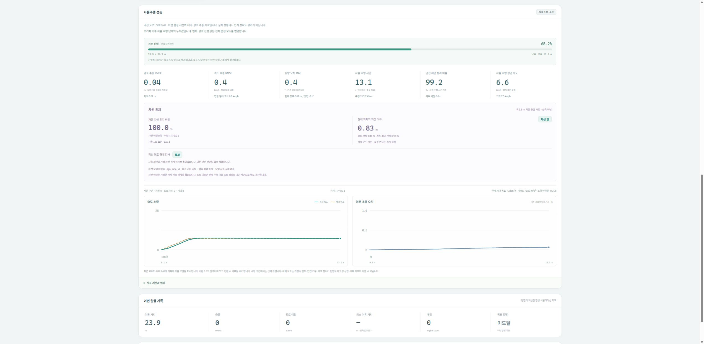

# 합성 차선 유지

차선 유지 기능은 시뮬레이터의 기준 경로에 폭 **3.6m**를 가정한 경계를
만들고, 차량의 위치·방향과 제안 경로를 검사합니다. 실제 차선 표식이나
OSM의 차선 폭을 측정한 결과가 아닙니다. 화면의 **가정 차선**과
`source: synthetic_assumed_lane_not_measured`가 이 출처를 표시합니다.

## 화면과 기록

주행 지도에 좌우 경계가 표시되고 성능 패널에 다음 값이 추가됩니다.

| 값 | 계산 |
|---|---|
| 차선 유지 비율 | 자율주행 시간 중 가정 차체의 둘레 표본이 모두 차선 안에 있는 시간의 비율 |
| 현재 차체 여유 | 차선 반폭에서 현재 차체 둘레의 최대 기준 경로 거리를 뺀 값. 음수면 이탈 |
| 차선 이탈 횟수 | 자율주행 중 안쪽에서 바깥쪽 상태로 바뀐 횟수 |
| 이탈 시간 | 자율주행 중 차체가 경계를 넘은 물리 서브스텝 시간의 합 |
| 합성 경계 검사 | 전체 제안 경로에서 차체 둘레와 0.1m 여유를 검사한 통과·거부 상태 |

차체는 후륜축 기준 전방 2.4m, 후방 1.0m, 폭 1.8m인 **가정 사각형**입니다.
둘레 표본 간격은 최대 0.1m이며, 이동 경로의 자세도 최대 0.1m 간격으로
검사합니다. 이는 이산 표본 검사이고 연속 영역 포함의 수학적 증명은 아닙니다.
기존 충돌·도로 이탈의 원형 차체 검사는 그대로 별도로 수행합니다.

현재 자세는 모든 운전 모드에서 표시합니다. 수동 주행의 시간·이탈 횟수는
자율 통계에 포함하지 않지만, 실제 이탈 상태와 최근 이벤트는 보입니다.
초기화하면 누적 통계가 초기화되며 자율 표본이 없을 때 비율은 `—`입니다.
단계·보고서·화면 조회만으로 통계가 늘어나지 않습니다.

`snapshot.lane`은 현재 상태·자율 누적·검사 결과·미학습 상태를,
`snapshot.world.lane`은 표시용 좌우 경계를 담습니다. 단계 로그와 결과
내보내기 JSON에도 같은 값을 보존합니다. 경계의 모서리 연결은 표시용이며,
실제 거리는 기준 폴리라인까지의 최단거리로 계산합니다. 시작·목표 지점은
접선 방향으로 20m 연장하여 정상적인 차체 길이와 목표 정지 초과를 허용합니다.

## 자율주행 연결

차선 경계를 벗어나는 제안은 `lane_boundary_veto`로 정지시킵니다.
기존 관측·점유·학습 도로 마스크·제동·곡률 검사는 함께 유지하며,
차선 검사 통과만으로 주행이 허용되지는 않습니다. 정지 잠금은 기존의
정지 상태·새로운 정상 관측·명시적인 해제 요청 조건을 따릅니다.
수동 모드는 기존 합성 실패 재현 기능대로 안전 거부를 우회할 수 있습니다.

도로 전체를 도로라고 예측하는 모델도 차선 경계 거부를 무시할 수 없으며,
차선 안의 경로라도 의미 분할이나 점유 검사에서 거부되면 정지합니다.
모든 실제 차량 출력은 계속 비활성입니다.

네 지역 합성 코스의 미래 경로는 현재 위치·방향·조향에서 출발하여 앞쪽
기준 경로를 계속 추종하는 자전거 모델 예측으로 생성합니다. 현재 속도와
제안 속도 중 큰 값을 예측 속도로 사용하고, 조향 변화율과 속도에 따른
곡률을 제한합니다. 한 조향각을 정지 거리 전체에 고정해 굽이가 변하는
차선 밖을 향하던 예측을 보완합니다. 예측이 실제 실행 궤적과 동일함을
증명하는 것은 아니며, 실제 차체 이탈은 물리 서브스텝마다 별도로 검사합니다.

## 학습 상태와 검증 범위

현재 차선 모델은 **미학습·미연결**입니다. 도로 의미 분할 모델을 차선
모델로 표시하지 않습니다. 기존의 학습 중지·모델 미채택 상태를 유지하며,
별도의 [차선 학습 자료 준비 도구](LANE_TRAINING_PREPARATION.md)는
명시된 다각형 주석을 검사·변환할 뿐 학습을 실행하지 않습니다.

검증은 기본 직선·곡선 완주, 지역 초기 실행, 차체 코너 이탈, 경계 여유에
의한 사전 거부, 수동 제외, 서브스텝 이탈 시간, 조회·초기화·로그 보존 및
학습 도로 마스크와 독립된 거부를 포함합니다. 합성 차선 유지 비율을
실제 차선 검출 정확도나 실제 차량 성능으로 해석하지 않습니다.
현재 소스의 검사 집계는 [차선 검증 기록](../reports/simulator_lane_validation.json)에
보존하며 이전 시뮬레이터 검증 보고서는 당시 소스의 기록으로 유지합니다.

최종 소프트웨어 검사 Python 255개와 화면 로직 13개가 통과했습니다.
부산 기본 자동 모드(seed 42)를 900단계·시뮬레이션 90초 실행한 추가 확인은
약 1.94km 이동, 차선 유지 100%, 차선 이탈·도로 이탈·충돌·안전 개입 0건이며
기존 조기 거부 구간을 통과했습니다. **전체 부산 코스 완주 결과는 아닙니다.**

진행 방향·중앙선 표시의 후속 보완과 도로/차로 구분은 [차로 분리 문서](TRAFFIC_AND_LANES.md)에 기록합니다. 해당 배치도 실측 차로 인식은 아닙니다.
