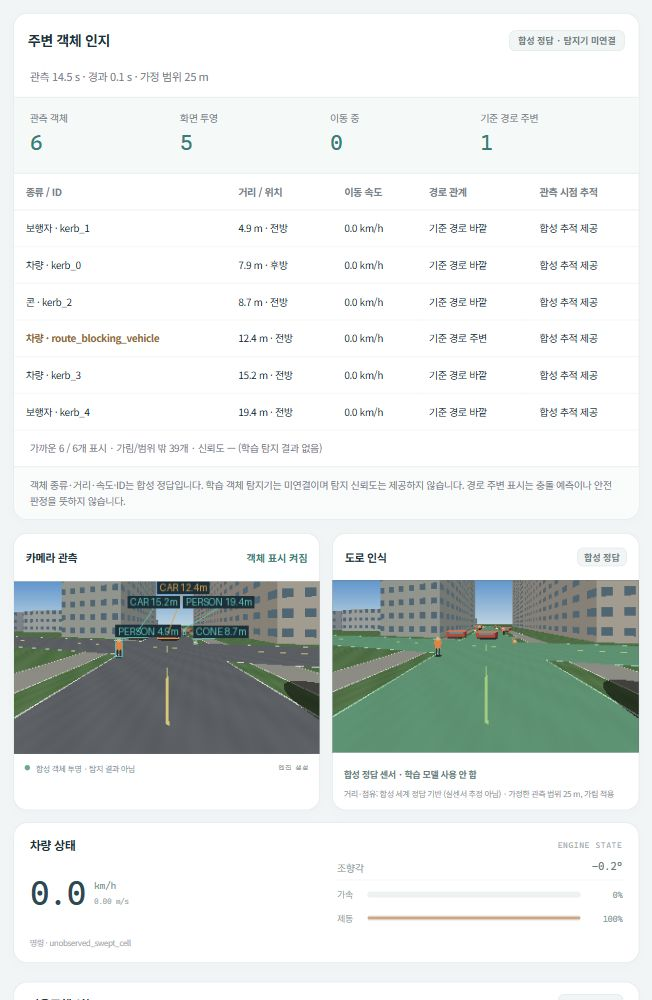

# 주변 객체 인지 표시

시뮬레이터는 객체의 종류·거리·이동 속도·ID와 카메라 투영 범위를 보여줍니다.
이 데이터의 출처는 `synthetic_geometry_not_learned_detection`이며 **학습 객체
탐지기는 연결하지 않았습니다.** 기존 도로 분할 모델을 선택해도 객체 정보는
합성 정답입니다. 탐지 신뢰도, 검출 정확도, 실센서 추적 성능을 만들어 표시하지 않습니다.

## 화면

- 카메라의 **객체 표시 켜짐/꺼짐**으로 표시 영상과 원본을 전환합니다.
- 상자는 렌더러의 가정한 객체 크기를 투영한 범위입니다. 픽셀별 객체 마스크나
  학습 탐지기의 bounding box가 아닙니다. 영어 종류와 거리를 표기하며 겹치는
  라벨은 다른 빈 위치로 배치합니다. 빈 위치가 없으면 상자만 남깁니다.
- **주변 객체 인지** 패널은 가까운 순서로 최대 8개의 종류·합성 ID·자차 중심까지의
  거리·전후 위치·절대 이동 속도와 해당 관측 시점의 안전 추적 제공 여부를 표시합니다.
  이동 중은 속도 0.1km/h 초과입니다. 관측 객체 수는 목록 8개 제한 전의 수입니다.
- 주황색은 전방에 있고 기준 폴리라인까지의 거리가 `2.7m + 객체 반경` 이하인 객체입니다.
  이는 경로 주변을 이해하기 위한 표시이며 충돌 예측·TTC·위험도나 정지 사유가 아닙니다.
  실제 정지 사유는 기존 안전 판단 패널에 별도로 표시합니다.
- 지도에서 진한 테두리와 거리 라벨은 **관측 시점 위치**를 표시합니다.
  흐린 기호는 현재 합성 세계의 정답 위치입니다. 표시의 시점 차이를 구분합니다.

## 관측·프레임과 안전 판단

객체 패널의 위치와 상자는 카메라 프레임을 생성한 시점에 함께 기록합니다.
시뮬레이션 상태는 그 뒤 물리를 한 단계 진행한 값이므로 보통 0.1초 차이가 있습니다.
관측 시각과 경과 시간을 표시하고, 프레임 고정 시 상자·위치·시각도 함께 고정합니다.
영상 손실 시 검은 프레임에 상자를 그리지 않고 패널을 사용 불가 상태로 표시합니다.
이는 별도의 합성 거리 채널이 사라졌다는 뜻이 아닙니다.

표시 객체는 자차 기준 가정 관측 범위 안으로 제한합니다. 서울·지역 코스는 기존
안전 계층과 같은 건물·다른 객체에 대한 중심점 가림 검사를 적용합니다.
일부 보이는 객체도 중심점이 가리면 제외될 수 있습니다. 이 검사는 카메라의
실제 픽셀 가시성이나 학습 탐지 실패율을 측정한 것이 아닙니다.
카메라 상자는 추가로 화면 경계와 100m 렌더 범위에 제한합니다.
360도 합성 거리 관측에 포함되더라도 카메라 시야 밖이면 패널에만 나타납니다.

기본 소형 코스의 기존 안전 계층은 관측 범위 밖 합성 추적도 제공할 수 있습니다.
객체 패널은 그 중 표시 범위 안의 객체만 보여주므로, 목록이 안전 계층 전체 입력과
같다는 뜻은 아닙니다. `safety_track_ids`는 해당 프레임 시점 검토에 제공된 합성 ID를
기록합니다. ID를 유지하는 것은 합성 행위자 식별자이며 데이터 연관 추적기를 평가한 결과가 아닙니다.

새 표시는 기존 안전 판단, 차선 검사, 조향·제동 입력을 변경하지 않습니다.
새 학습·다운로드·모델 교체나 실제 차량 출력도 시작하지 않습니다.

## API와 검증

- `GET /api/state` 및 결과 JSON의 `object_perception`: 관측 출처·시각·범위·객체·투영 범위
- `GET /frames/objects.png`: 현재 합성 카메라에 객체 범위를 표시한 PNG
- `GET /frames/camera.png`: 원본 합성 카메라 PNG

범위·가림·좌표 변환·상자 클리핑·원본 보존·조회 순수성·프레임 고정·영상 손실을
합성 CPU fixture로 검사합니다. UI는 출처/미제공/고정/손실 표시, 8개 목록 제한,
문자열 안전 출력 및 제어 명령을 보내지 않는 원본 전환을 검사합니다.
기존 검증 보고서는 당시 소스의 기록으로 보존합니다.

