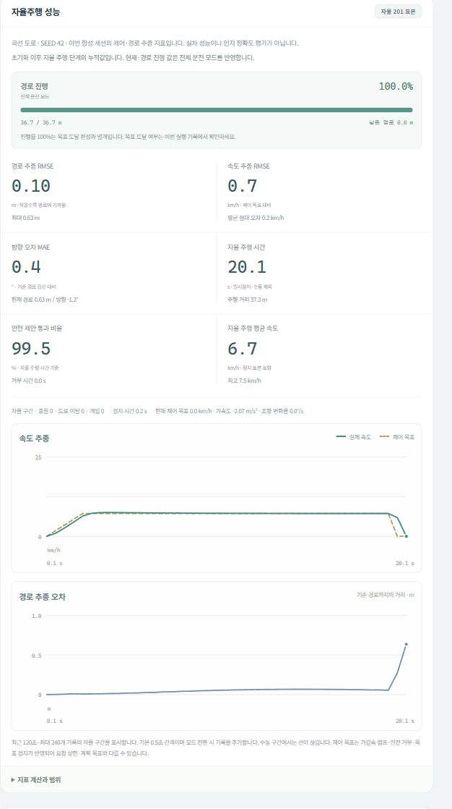

# 합성 시뮬레이터의 자율주행 성능 지표

Drive Lab의 **자율주행 성능** 패널은 현재 실행의 엔진 상태로 계산한다.
실제 차량, 카메라 인식 정확도, 사고 확률 또는 안전 인증 점수가 아니다.
기존 모델 평가표와 미채택 판단, 학습·자동화 중지 상태는 변경하지 않는다.

## 수집 범위

고정 시뮬레이션 간격(현재 0.1초)의 실행 단계가 끝날 때 한 번 기록한다.
일시정지, 화면·프레임·보고서 조회, 속도 설정 변경은 표본을 추가하지
않는다. 종료된 실행의 재조회도 표본을 늘리지 않는다. 초기화는 새 실행의
통계를 시작하며 기존 출력 폴더의 이전 실행 기록은 보존한다.

현재 경로 진행률과 현재 위치·방향 오차는 수동 모드에서도 표시한다.
**자율 누적** 통계에는 자율 모드로 실행한 단계만 포함한다. 수동 조작의
시간·거리·오차·충돌·이탈을 자율주행 결과에 합치지 않는다. 첫 관측을
기다리는 자율 warmup 단계는 자율 시간과 오차 표본에 포함한다.

## 계산 기준

| 지표 | 정의 |
|---|---|
| 경로 진행률 | 현재 위치를 기준 경로에 최근접 투영한 호 길이 ÷ 전체 기준 경로 길이. 0–100%로 제한하며 뒤로 이동하면 감소할 수 있다. |
| 경로 오차 | 차량 기준점에서 유한한 기준 경로의 가장 가까운 점까지의 거리(m). 경로 끝을 넘으면 끝점까지의 거리도 포함한다. |
| 경로 RMSE | `sqrt(sum(오차² × dt) / 자율 시간)`. 경로 최대 오차도 전체 자율 표본에서 계산한다. |
| 방향 오차 | 최근접 경로 선분의 접선과 차량 방향의 차이를 ±180도로 감싼 값. 방향 MAE는 절댓값의 시간 가중 평균이다. |
| 속도 RMSE / MAE | 실제 속도와 **제어기의 가감속 제한 후 목표**의 차이에 대한 시간 가중 오차(km/h). 사용자 상한이나 계획 목표와는 다를 수 있다. |
| 정지 시 제어 목표 | warmup, 안전 거부, 목표 앞 제동, 0km/h 요청 등 tracking 이외의 명령에서는 0이다. 수동 구간에는 자동 속도 제어 목표가 없다. |
| 평균 속도 | 자율 모드에서 실제 적분한 이동거리 ÷ 자율 시간 × 3.6. 정지 시간도 분모에 포함한다. 최고 속도는 자율 단계 종료 시각의 속도 표본 중 최댓값이다. |
| 안전 통과 비율 | `proposal_eligible`인 자율 시간 ÷ 전체 자율 시간 × 100. warmup도 분모에 포함한다. 안전 보장 확률이 아니다. |
| 안전 거부 시간 | `proposal_eligible=False`인 자율 시간 중 warmup을 제외한 시간. 통과 비율의 단순 보완값이 아니다. |
| 안전 개입 | 기존 안전 거부 상태로 새로 진입한 사건 중 자율 단계에서 발생한 횟수. 사람의 수동 인계 횟수가 아니다. |
| 정지 시간 | 단계 종료 속도가 0.02m/s 이하인 자율 표본의 시간 합계. |
| 충돌·이탈 | 자율 단계 전후의 기존 세계 기하 사건 카운터 차이. 수동 단계에서 발생한 사건은 제외한다. |
| 현재 가속도·조향 변화율 | 연속된 실행 단계 종료값의 차이 ÷ 시뮬레이션 간격. 실측 IMU·조향 센서 값이 아니다. |

기본 코스의 기준 경로는 초기 위치 x=0부터 목표 x=36m까지이고,
그리기용 도로의 여분 구간은 진행률 분모에 넣지 않는다. 서울 및 새 지역
코스는 해당 장면의 기준 주행 경로를 사용한다. 이 기준선은 차선별 합법
주행 정답이 아니다. **진행률 100%는 정지·자세·충돌·이탈 이력을 포함한
목표 도달 판정과 다르다.**

자율 표본이 없으면 RMSE·MAE·평균/최고 속도·안전 통과 비율은 `null`이고
화면에는 `—`를 표시한다. 시간·거리·사건 수는 0으로 표시한다. 처음부터
정지한 실행의 오차가 작다는 사실만으로 주행 성능이 좋다고 판단하지
않으며 진행률·자율 거리·목표 도달·안전 사건을 함께 확인한다.

## 그래프와 저장

속도와 경로 오차 이력은 전체 모드에서 기본 0.5 시뮬레이션 초 간격으로
저장하고 운전 모드가 바뀐 단계에는 즉시 기록을 추가한다. 최근 120초,
최대 240점으로 제한한다. 화면의 자율 그래프는 수동
구간을 연결하지 않는다. 이는 실시간 FPS나 추론 처리 속도 벤치마크가
아니다. 누적 RMSE·시간·거리 등은 최근 그래프 범위를 넘어 전체 자율
표본을 유지한다.

`GET /api/state`, `GET /api/report`의 snapshot, `steps.jsonl`, 종료 요약에
같은 `performance` 구조를 저장한다. `route`는 현재 위치, `autonomous`는
자율 누적, `current`는 마지막 단계의 제어·동역학 값, `history`는 제한된
이력, `definitions`는 계산·범위 설명이다. `performance.session`의 전체·수동
표본 수와 혼합 실행 여부는 이력이 만료된 후에도 유지한다. 초기화 전후 실행은 session과
시나리오·시드로 구분한다. 단일 실행에서 임의의 성공률이나 종합 안전
점수를 만들지 않는다.

## 확인한 예시와 검사

시드 42의 기본 합성 곡선 코스는 201단계(시뮬레이션 20.1초)에 목표에
도달했다. 자율 거리 37.28m, 경로 RMSE 0.1030m, 방향 MAE 0.3557도,
속도 RMSE 0.6643km/h였다. 정지 장애물 예시는 안전 거부·제동으로 멈췄고
목표에는 도달하지 않았다. 낮은 경로 오차만으로 완주로 집계하지 않는다.
이 예시는 학습 모델을 연결하지 않은 합성 정답 센서의 소프트웨어 결과다.

통계 단위 검사 10개, 엔진 연동 검사 16개, 화면 로직 검사 6개를
확인했다. 기존 시뮬레이터 회귀도 확인했으며 전체 저장소 검사를 새로
실행한 것은 아니다. 테스트 범위, 초기 Windows HTTP 연결 중단과 단독
재검사 결과, 예시 수치·소스 해시는
[성능 지표 검증 집계](../reports/simulator_performance_validation.json)에 보존한다.

