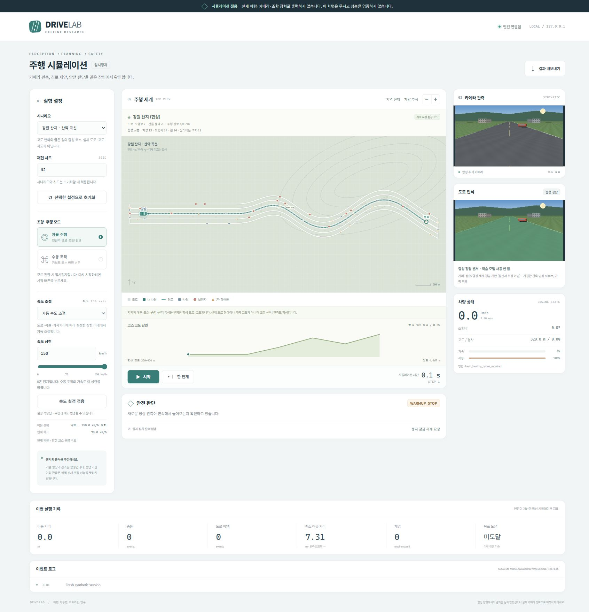

# 지역 테마 합성 연구 코스

부산·광주·전남 순천·강원 산지를 떠올릴 수 있는 **합성 연구 코스**를
시뮬레이터에 추가했다. 도로·건물·풍경·고도·폭은 저장소에서 직접 만든
가정값이다. 실제 지도, 위성 지형, 측량, DEM, 실제 지역 도로망을 사용하지
않았다. 서울 성수동의 기존 OSM 추출 자료와 출처가 다르다. 지역명은 풍경
테마를 뜻하며 실제 도로 배치나 주행 허가를 뜻하지 않는다.

| 코스 자료 ID | 화면 이름 | 구성 | 최초 직선 |
| --- | --- | --- | --- |
| `busan` | 부산 해안·구릉 (합성) | 해안 풍경·완만한 구릉, 약 3.6 km | 1.2 km |
| `gwangju` | 광주 도심·평지 (합성) | 넓은 도심 직선·완만한 굽이, 약 3.4 km | 2.4 km |
| `suncheon` | 전남 순천 들판·습지 (합성) | 들판·습지 풍경·완만한 굽이, 약 3.5 km | 1.4 km |
| `gangwon` | 강원 산지 (합성) | 산림 풍경·굽이·오르막·내리막, 약 4.0 km | 1.2 km |

브라우저 장면과 CLI의 `--scenario`에는 각각 `busan_day`, `gwangju_day`,
`suncheon_day`, `gangwon_day`를 사용한다.

경로 길이는 곡선의 폴리라인 호 길이이므로 표의 근사값보다 조금 길 수
있다. 각 코스는 기준 경로 외측에 배경 도로를 두어 기존의 시드 기반
합성 차량·보행자·콘 배치를 지원한다. 배경 도로와 건물 역시 가정이다.
운용자가 도로의 끝에서 정지할 때 차량 전체가 들어가도록 노면은 경로
시작·종료 지점보다 180 m 연장했다.

`camera_rc.simulator.terrain.load_course(id)`는 기존 지역 엔진이 사용하는
`roads`, `buildings`, `route`, `full_route`, `bounds_m` 구조를 반환한다.
`geometry_source=synthetic_regional_course`, `synthetic=true`, 출처·한계,
`terrain.elevation_profile`을 함께 보관한다. 지도/측량 자료가 없으므로
실제 위도·경도와 연결하지 않는다. 코스는 결정적으로 생성되며 네트워크나
추가 파일 다운로드가 필요 없다.

고도 프로필의 `distance_m`는 경로 호 길이, `elevation_m`는 임의 기준면에
대한 가정 높이다. `elevation_at(course_or_id, progress_m)`는 구간별 선형
보간 높이, `grade_at(...)`는 상승량/전진거리 비율을 반환한다. 예를 들어
0.05는 5% 가정 경사다. 범위를 벗어난 위치는 가장 가까운 끝 지점으로
제한한다. 강원 코스에는 320–454 m의 가정 높이와 상승·하강 구간을,
광주 코스의 최초 긴 직선에는 0% 가정 경사를 둔다.

이 구조는 평면 도로 기하와 스칼라 종방향 경사를 결합한다. 타이어,
서스펜션, 횡경사, 수직 가림, 실제 엔진·제동 장치의 3D 동역학을 재현하지
않는다. 150 km/h는 합성 시뮬레이터의 설정 범위이며 해당 속도의 실차
센서·제동·안전·폐루프 주행이 검증됐다는 뜻이 아니다.

기존 모델 평가와 학습 상태는 유지한다. AI Hub 추가 학습 모델과 보정
후보는 운용 개선 모델로 채택하지 않았으며, 학습과 반복 자동화는 중지된
상태다. 처리 속도 비교는 취소된 상태이고 이번 코스 추가로 재개하지
않는다. 실제 MSI 4/8 GB 성능, 실차 센서·제동·비상정지·폐루프 주행은
검증하지 않았다. 지역 코스의 합성 검사는 기존 고정 평가셋 결과나
실차 성능의 근거를 변경하지 않는다.

## 이번 소프트웨어 검증

시뮬레이터 Python 검사 165개, 기존 독립 안전/제어 검사 109개,
Node 화면 로직 검사 3개가 통과했다. 이는 전체 저장소 검사를 새로
수행한 수치가 아니다. 광주 기본 합성 코스에서 정지 상태부터
500단계(시뮬레이션 50초) 자동 가속하여 실제 상태 속도 150km/h,
이동 거리 약 1,214.33m, 충돌·이탈 0건을 기록했다. 전체 코스 완주는
확인하지 않았다. 곡선·목표 앞 제동은 별도의 특정 지점 회귀 검사다.

브라우저에서는 지역 초기화, 자동 요청150/강원 목표70 표시, 사용자
80km/h 적용, 주행 중0 요청 후 정지와 일시정지를 확인했다. 자세한
범위와 소스 해시는 [집계 JSON](../reports/simulator_regional_speed_validation.json)에 있다.

