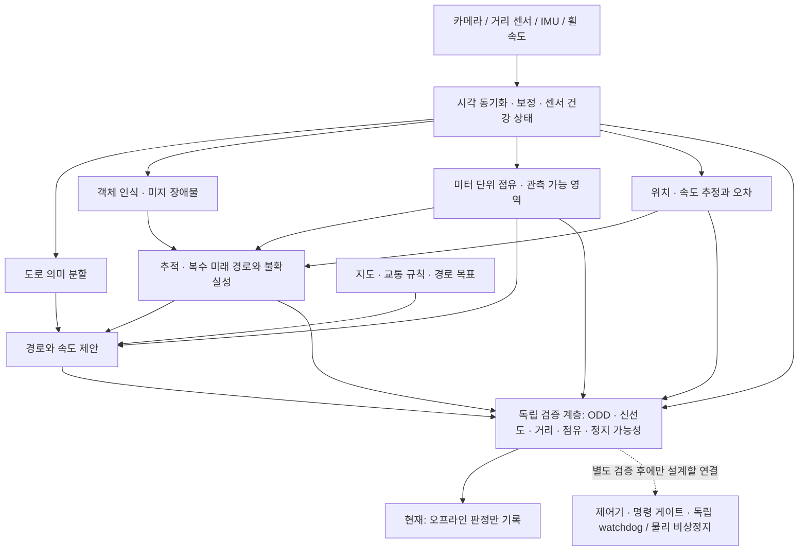

# 실제 차량을 염두에 둔 오프라인 안전 구조

이 문서는 **설계 제안과 구현된 소프트웨어 검사 범위**를 구분합니다. 목표는 충돌 위험을 줄이는 것이지만, 현재 모델·자료·시험으로 절대 무사고를 보장할 수 없습니다. 실제 차량용 완제품, 안전 인증, 공도 운행 승인 또는 80km/h 검증 결과가 아닙니다. 실차 제어를 실행하거나 배포 모델을 교체하지 않았습니다.

## 1. 결론과 현재 구현 범위

도로 분할 모델 하나를 조향·가속 판단에 직접 사용하는 구조로는 충분하지 않습니다. 도로처럼 보이는 픽셀은 장애물이 없는 공간, 실제 거리, 충분한 제동거리 또는 합법적인 진행 경로를 뜻하지 않습니다. **복수의 인식 기능과 독립된 규칙 기반 검증 계층**으로 확장합니다. 서로 상관된 모델 여러 개의 찬성표를 안전 근거로 사용하지 않습니다.

| 구분 | 이번 상태 |
|---|---|
| 도로 분할 및 선택적 객체 인식 | 기존 연구 구현과 성능표 유지; 새 정확도 개선을 주장하지 않음 |
| 명시적 모듈 건강 상태·시각·버전·보정 계약 | `ModuleEvidence`, `SceneEvidence`에 구현 |
| 미관측/점유/객체/이상 영역의 거부 | `ShadowSafetySupervisor`에 구현; 입력은 외부 생산자가 제공해야 함 |
| 차량 크기·오차를 포함한 경로 영역 검사 | 미터 격자의 연속 선분을 보수적으로 덮는 원형 외곽 검사 구현 |
| 제동·예측 시간 범위 검사 | 주어진 물리 상한/하한에 대한 계산 구현; 실제 제동 성능 측정 미완료 |
| 동적 객체의 도달 가능 영역 검사 | 속도·위치·가속 오차 상한을 사용한 보수적 겹침 검사 구현 |
| 실제 거리 추정·센서 융합·추적·위치 추정 모델 | **새 검증 계층에 연결된 실센서 생산자 없음** |
| 호스트/MCU 참조 코드의 잘못된 시각 처리 | 기존 출력 중지 및 복구 잠금 회귀 보완 |
| 합성 시나리오 | 30개 조건의 기대 동작 검사; 충돌률·실제 센서 성능을 측정한 시험 아님 |
| 실차 연결 | 없음; 검증 계층의 `actuation_enabled`는 항상 `False` |

`PROPOSAL_ELIGIBLE`은 전달된 오프라인 증거가 검사 조건을 만족했다는 뜻입니다. 주행 명령이나 안전 보증이 아닙니다. 모든 입력이 거짓이거나 생산자가 잘못된 보정/오차를 보고하면 이 검사도 현실의 위험을 놓칠 수 있습니다. Python 프로세스의 별도 클래스는 전원·컴퓨팅·센서 고장에 독립된 하드웨어 안전 채널이 아닙니다.

## 2. 목표 운행 범위부터 고정

사용자에게 도로 유형과 차량/센서 구성을 요청했습니다. 답변 전에는 **사람과 분리된 폐쇄 코스의 저속 운행을 가정한 오프라인 설계**만 진행합니다. 합성 예제의 최대 1m/s, 제동 감속 0.8m/s², 차량 반경 0.4m 등은 테스트 숫자이며 실차 설정으로 복사하면 안 됩니다.

실차 설계에는 최소한 다음이 필요합니다.

- 차량 크기, 후륜축 기준 앞뒤 돌출부, 질량 범위, 조향 제한과 실제 제동 지연·감속 하한.
- 운행 구역, 최고 속도, 노면/경사, 낮·밤·비·안개 허용 여부, 보행자·교차로·합류 여부.
- 카메라 수·설치 위치·노출/해상도/시간 동기화, LiDAR/레이더/스테레오, IMU·휠 속도계·GNSS 유무.
- 독립된 물리 비상정지, 제동 전원/통신, watchdog, 수동 인계와 통신 단절 시 동작.

검증하지 않은 야간·날씨·속도는 허용 조건에 넣지 않습니다. 공도에서는 차로 안 급정지도 새로운 위험을 만들 수 있어, 여기의 정지 판단을 그대로 사용하면 안 됩니다. 위험 최소화 동작은 차종·노면·주변 교통·운전자 인계 조건별로 설계하고 검증해야 합니다.

## 3. 다중 모델과 통합 구조



이 저장소에서 새로 실행되는 것은 마지막 검증 계층의 합성 검사입니다. 전체 그림에 실제 학습된 모델이 모두 연결됐다는 뜻이 아닙니다. 기존 `Perception.drivable`과 빈 `detections`만으로 `SceneEvidence`를 만들 수 없습니다. 정상 실행 결과 객체 0개, detector 미설치, timeout, 모델 실패는 서로 다른 상태입니다.

역할별 후보를 비교하되 다음 근거를 우선합니다.

| 역할 | 설계 방향 | 선택 전 필요한 증거 |
|---|---|---|
| 도로 인식 | 현재 분할 모델을 기준선으로 두고 희소 감독·출처 회귀를 해결 | 같은 고정 보고셋, 별도 개발셋, 조건별 IoU/recall/FPR |
| 객체/미지 장애물 | 알려진 클래스 검출과 미지 물체 거부를 함께 사용 | 작은/가려진/야간 객체 누락, 미지 장애물, 과도한 정지율 |
| 거리/점유 | 가능한 실제 거리 센서와 카메라의 상호 검증 | 보정, 시간 정렬, 자유 공간 관측 근거, 거리 오차 상한 |
| 시간 통합 | 객체 ID 추적과 여러 가능한 움직임을 포함한 예측 | 유실·재등장·급진입·시간 지연·오차 증가 처리 |
| 계획/제어 | 해석 가능한 제약으로 경로·속도 제안 검증 | 동역학 제약, 제동 하한, 닫힌 고리 시험, 하드웨어 오류 주입 |

BEV나 end-to-end 모델도 후보일 수 있지만, 이름이나 공개 벤치마크 점수만으로 현재 시스템보다 안전하다고 선택하지 않습니다. 레이더/LiDAR 추가도 보정·가림·기상·공통 전원 고장을 제거하지 않습니다. LLM/Agent는 오프라인 원인 분석, 데이터 조사, 실험 계획에 사용하며 직접 actuator 명령을 만들거나 검증 계층을 우회할 권한을 갖지 않습니다.

### 낮/밤 모델을 나눌지

현재는 두 모델로 나누는 것이 더 안전하다는 실험 근거가 없습니다. AI Hub 야간 공식 검증 785장에는 보행자·자전거·오토바이·라이더·콘 주석이 없어 야간 도로 점수로 이 객체의 성능을 판단할 수 없습니다.

우선 공통 모델에 충분한 조건별 자료와 빈도 균형, 불확실성/ODD 거부를 갖추는 설계를 기준으로 둡니다. 별도 주야간 전문가 모델은 공통 기준선보다 각 조건과 전환 구간에서 좋아지는지 개발 자료로 검증한 후 고려합니다. 터널·역광·황혼·헤드라이트·노출 전환에서 분기 오류와 출력 불연속을 측정해야 하며, 시각이나 화면 평균 밝기만으로 안전 모드를 선택하지 않습니다. 현재 코드에는 검증되지 않은 자동 주야간 모델 전환을 추가하지 않았습니다.

## 4. 구현된 증거 계약과 보수적 거부

필수 모듈은 `semantic`, `objects`, `metric_occupancy`, `tracking`, `localization`입니다. 모두 정상 상태, 승인된 생산자 SHA256, 같은 보정 SHA256·clock domain을 제공해야 합니다. 자료의 capture 시각과 sequence가 각각 증가해야 하며 새 수신 시각만 붙여 오래된 관측을 재사용할 수 없습니다. 미래 시각·과도한 나이·노출 간격도 거부합니다. SHA는 계보를 묶으며 생산자의 정확성이나 인증을 입증하지 않습니다.

이 API는 모든 필수 모듈의 새 관측을 가진 융합 주기의 제안을 검사하는 계약입니다. 다른 주기의 센서나 고속 제어 loop에 그대로 연결하면 반복 관측을 거부하므로, 비동기 생산자 조합과 command 수명은 별도 설계·검증해야 합니다. 합성 예제의 임계값과 오차 한계는 실제 센서에서 보정된 안전 경계가 아닙니다.

격자, 객체 궤적, 계획은 같은 차량 상태의 ego anchor 시각과 후륜축 좌표를 사용합니다. 상류에서 실제 ego motion compensation과 그 오차 한계를 계산해야 합니다. 상태 나이와 보정 오차도 여유에 반영하지만 임의로 `metric_scale_verified=True`를 넣는 것은 검증이 아닙니다.

차체 전체를 감싸는 후륜축 중심 반경, 측면 여유, 위치/시각/보정 오차를 함께 고려합니다. 경로를 격자 간격의 절반과 독립적인 경로 검사 간격 상한 중 작은 값으로 표본화하고, 표본 사이 공간과 교차 격자까지 팽창시켜 검사합니다. 하나의 미관측·점유·객체/이상 격자도 전체 평균 도로 확률로 덮어쓰지 않습니다. 긴 두 선분으로 직각 경로를 제시해도 촘촘한 검사 경로에서 곡률 한계를 위반하면 거부합니다. 이 검사는 매끄러운 동역학 궤적의 실현 가능성 증명은 아닙니다.

정지거리의 내부 근사식은 다음과 같습니다.

```text
v_now_upper = 관측 속도 + 속도 오차 상한 + 가속 상한 * 상태 나이
v = max(v_now_upper, 제안 속도 + 속도 오차 상한)
t = 관측/상태/계획 중 최대 나이 + 남은 처리/제동 지연 상한
v_after_delay = v + 지연 중 가속 상한 * t
d_stop = v*t + 0.5*a*t² + v_after_delay²/(2*제동 감속 하한) + 정지 여유
```

전진·명시적 가속/제동 경계에 한정한 모델입니다. 현재 속도 상한과 지연 말 속도도 ODD 한계를 넘을 수 없으며 경로 횡가속에는 지연 중 최고 속도를 사용합니다. 상태 나이를 속도와 지연에 모두 포함하는 계산은 보수적 중복 여유를 가집니다. 노면 마찰, 경사, 적재, 제동 고장, 젖은 노면 등을 포함해 **실제로 측정된 보수적 경계**가 있어야 차량에 적용할 수 있습니다. 계획 길이가 이 거리보다 짧거나 추적 예측이 상태 나이와 정지 시간 전체를 덮지 못하면 거부합니다.

동적 객체는 현재 위치와 선형 이동 구간에 위치·속도·가속 오차를 팽창시킨 도달 가능 영역으로 확인합니다. 시간별 교차 여부보다 보수적으로 전체 경로와 겹침을 거부하므로 불필요한 정지가 증가할 수 있습니다. 상호작용·다중 의도·가려진 객체의 완전한 예측기가 아닙니다.

오류 발생 후 정상 자료 한 번으로 복구하지 않습니다. 연속된 새 정상 관측과 명시적 reset, 속도 오차까지 포함한 정지 상태가 필요합니다. reset도 이전 관측의 재사용 방지 이력을 지우지 않습니다. 초기에도 연속 정상 관측을 기다립니다. 자료 크기·경로 길이·추적 수의 예산 초과는 거부하지만 Python 실행시간의 hard real-time 보장은 없습니다.

## 5. 데이터 조사와 추가 취득의 목적

| 자료 | 현재 확인한 것 | 실차 구조에 부족한 것 |
|---|---|---|
| AI Hub 13–15 | 유효 train 18,932 / val 2,367; 원본 polygon/영상 검사 | 72–80% ignore, 야간 취약 객체 주석 부족; 검증된 미터 거리·ego 운동/제어 정답 없음 |
| ACDC | train 1,600 / val 406 준비·검증, 야간 400 / 106 포함 | 실제 거리/제어 정답은 이번 준비 범위에 없음; 학습 효과 아직 측정 안 함 |
| A2D2 로컬 부분집합 | 41,277 RGB/semantic 쌍, 23 sequence, 보정 파일 | LiDAR 미취득; 동기화된 다중 시점 sample 구성 미완료; vehicle bus 없음 |
| BDD 로컬 부분집합 | train 70,000 / val 10,000 이미지 및 drivable | 해당 취득 범위에 검증된 연속 영상·속도·보정 없음 |
| KITTI Road | 289개, 보정 파일 | 해당 부분집합에 우측 스테레오·Velodyne·연속 odometry 없음 |
| Virtual KITTI 2 | 42,520 RGB/semantic 쌍, intrinsic/extrinsic/pose/bbox | 합성 자료; depth/flow/instance 미취득. bbox occupancy 비율은 3D 점유 격자가 아님 |
| nuScenes mini | 공식 4.17GB 원본 취득·압축 검사; 10 scene / 404 sample / 31,206 sensor records / 18,538 boxes 메타데이터 검사 완료 | 통합 점검 자료; 안전 성능 시험셋이나 dense 자유 공간 정답이 아님 |

nuScenes mini 취득의 최종 상태는 [별도 집계](../reports/nuscenes_mini_intake.json)에서 확인합니다. 원본 archive는 공개 저장소에 넣지 않습니다. gzip CRC/tar 경로/metadata 참조 검사와 실제 이미지·점군 전체 해독 검사는 서로 다릅니다. 취득 검사가 통과해도 인식·융합·주행 시험 완료로 표현하지 않습니다. mini scene은 전체 nuScenes와 겹칠 수 있어 전체 자료로 확장할 때 scene 단위 중복 검사를 해야 합니다.

실제 검사에서는 284,361회 참조 및 120개 센서 체인을 확인했습니다. 첫 지도 참조 검사는 mini 밖의 로그 때문에 중단됐으며 실패를 보존했습니다. 별도 v2 검사에서 로컬 8개 로그는 각각 하나의 지도에 연결됐고, 지도 목록의 외부 75개 로그는 검증 범위 밖으로 남겼습니다. 카메라 timestamp와 sample/LiDAR 시각의 절대 차이는 최대 **48.349ms**였습니다. 같은 sample에 묶였다고 노출 시각까지 동일한 것으로 처리하면 안 됩니다. 공급자 SHA256은 확보하지 못했으며 기록한 SHA256은 수신 파일의 로컬 지문입니다. 전체 gzip CRC와 전송 크기 일치를 별도로 확인했습니다.

이 자료는 비상업 연구 조건으로 취득합니다. nuScenes는 CC BY-NC-SA 4.0과 추가 Dataset Terms를 함께 확인해야 하며 상업 차량 개발 권한이 자동으로 생기지 않습니다. 코드의 AGPL 라이선스와 데이터/가중치 이용권은 별개입니다. [공식 약관](https://www.nuscenes.org/terms-of-use), [공식 형식](https://www.nuscenes.org/data-format), [schema](https://github.com/nutonomy/nuscenes-devkit/blob/master/docs/schema_nuscenes.md).

기존 고정 보고셋·public 장애물 40장은 계속 보고용으로 유지합니다. 이미 반복 평가와 부모 모델 선택에 사용된 자료를 새 블라인드 시험이라고 부르지 않습니다. 예측을 정답으로 변환하거나 안전 점수를 높이려고 위험 사례를 제외하지 않습니다.

## 6. 실행과 결과의 의미

CPU 테스트 환경에서 저장소 루트 기준으로 실행합니다. 새 출력 경로만 허용하며 기존 결과를 덮어쓰지 않습니다.

```bash
python scripts/check_shadow_safety.py --output runs/shadow-contract-001.json
python -m pytest tests/test_shadow_safety.py tests/test_runtime_contract.py tests/test_mcu_reference.py -q -p no:cacheprovider --basetemp=runs/shadow-tests-001
```

첫 명령은 실제 모델 추론·데이터 다운로드·GPU·카메라·serial·속도 측정을 실행하지 않습니다. 결과의 `actuation_enabled`, `collision_rate_measured`, `model_inference_performed`는 모두 false입니다. [30개 합성 시나리오 결과](../reports/shadow_safety_validation.json)는 실행 소스 SHA256을 포함합니다. 검사 범위에는 정상 빈 객체 목록, 모듈 누락/실패, 잘못된 시각/보정/모델, 미관측·작은 점유 격자, 동적 접근, 제동 오류, ODD 이탈 등이 있습니다.

| 요구사항 | 코드/회귀 검사 | 아직 필요한 현실 근거 |
|---|---|---|
| 실패한 인식을 정상 빈 결과로 사용하지 않음 | 필수 `ModuleEvidence.status`; 누락/실패 case | 실제 producer timeout·부분 실패 전파 |
| 오래된 자료가 새 자료처럼 통과하지 않음 | 시각·sequence·anchor·clock 검사 | 센서 노출 시각과 시계 동기화 오차 측정 |
| 경로 사이 작은 미관측/장애물을 평균으로 숨기지 않음 | `single_cell_at_body_edge`, sparse path case | 실제 거리 센서의 공간 해상도·가림·miss 검증 |
| 정지 범위가 관측/예측 범위를 넘지 않음 | speed age·delay·braking·prediction horizon tests | 노면별 제동 하한과 지연 상한 측정 |
| 큰 격자가 급회전을 숨기지 않음 | coarse grid 20m 직각 경로 회귀 | 실제 차체/조향/타이어 동역학 검증 |
| fault 후 저절로 재출발하지 않음 | fresh evidence·explicit reset·current speed upper tests | 물리 rearm·정지 센서·사람 인계 절차 |
| 검사 통과가 actuator 활성화가 아님 | 모든 시나리오의 `actuation_enabled=False` | 별도 검증된 제어/하드웨어 경계와 승인 |

전체 소프트웨어 검사와 실행 환경은 [이번 검사 집계](../reports/safety_architecture_software_validation.json)에 분리해 보존합니다. 테스트 수를 주행 거리나 충돌 확률로 변환하지 않습니다.

도로 인식·장애물 오인의 실제 측정값은 기존 [RESULTS](RESULTS.md)를 그대로 사용합니다. **이번 구조 추가로 IoU, 장애물 오인율, 처리 속도가 좋아졌다는 새 결과는 없습니다.** 이전 속도 비교 취소와 학습/자동화 중지 상태를 유지합니다.

## 7. 실제 운용 전 남은 단계와 중단 조건

1. **ODD·차량 계약 확정:** 센서/차체/브레이크/수동 인계 경계를 명시하고 위험 분석·검증 책임을 정합니다.
2. **실센서 생산자 구현:** 시각 동기화와 보정, 미터 점유, 추적/위치 오차 및 건강 상태를 실제 자료에서 만듭니다. 데이터 출처·장면 분할·라벨 범위를 고정합니다.
3. **기록 자료 재생:** 객체별/거리별/주야간 누락, 자유 공간 오인, 불확실성 보정, 거부율·불필요한 정지율을 측정합니다. 관측하지 못한 영역을 정답 자유 공간으로 간주하지 않습니다.
4. **닫힌 고리 시뮬레이션:** CARLA/ScenarioRunner 같은 환경에서 급진입·가림·신호·노면·지연·프레임 동결·센서 손실·위치 드리프트·제동 저하를 주입합니다. recorded replay는 새 제어기가 환경을 바꾸는 closed-loop 시험과 구분합니다.
5. **하드웨어 결합 시험:** 프로세스 정지, 통신/전원 단절, watchdog·실제 브레이크·물리 비상정지를 사람과 분리한 장치에서 확인합니다.
6. **제한된 폐쇄 코스 및 독립 검토:** 측정한 경계 안에서 단계적으로 검증하고, 불확실하거나 요구사항 미충족이면 확장하지 않습니다. 이 저장소는 이 단계들의 실행 승인을 제공하지 않습니다.

평가 항목에는 도로 IoU/recall/FPR 외에 거리별 객체 누락, TTC/여유 거리, 충돌/접촉/근접 사례, 개입, 교통 규칙 위반, 정지 완료, 위험 최소화 실패, 시스템 가용성도 필요합니다. 분모·운행 조건·샘플 수·신뢰 구간을 명시하고 0건 관측을 위험 0의 증명으로 해석하지 않습니다. 검증 계층의 과도한 거부로 작업이 전혀 수행되지 않는 문제도 별도로 측정합니다.

현재 가장 큰 차이는 더 큰 backbone이 없는 것이 아니라 **검증된 실센서 거리/시간/동역학 경계와 닫힌 고리 검증이 없다는 점**입니다. 이 정보 없이 추가 학습만 반복하지 않습니다.

## 8. 참고한 1차 자료와 적용 한계

- [ISO 26262-1:2018 공개 개요](https://www.iso.org/standard/68383.html): E/E 오동작 관련 기능 안전의 범위를 참고했습니다. 전체 유료 표준의 요구사항 검증이나 적합성 평가를 수행하지 않았습니다.
- [ISO 21448:2022 공개 개요](https://www.iso.org/standard/77490.html): 성능/명세 부족과 예견 가능한 오용을 포함한 SOTIF 관점을 참고했습니다. 인증/준수 선언이 아닙니다.
- [NHTSA ADS 2.0](https://www.nhtsa.gov/document/automated-driving-systems-20-voluntary-guidance): ODD와 fallback을 포함한 2017년 미국 자발적 지침입니다. 한국 공도 운행 허가 근거가 아닙니다.
- [Autoware vehicle command gate](https://autowarefoundation.github.io/autoware_universe/main/control/autoware_vehicle_cmd_gate/): 계획 명령과 비상/외부 명령의 경계를 분리하는 구조를 참고했습니다. Autoware 구현을 이 프로젝트에서 검증했다는 뜻은 아닙니다.
- [RSS 원 논문](https://arxiv.org/abs/1708.06374): 명시된 가정 아래 해석 가능한 거리/행동 제약의 필요성을 참고했습니다. 위 간단한 제동식이 RSS 전체 구현이나 무사고 정리의 적용은 아닙니다.
- [UL 4600 Edition 3 공식 안내](https://www.shopulstandards.com/ProductDetail.aspx?productId=UL4600_3_S_20230317): 주장·근거를 연결하는 안전 논증의 방향을 참고했습니다. UL 평가/인증을 받지 않았습니다.
- [CARLA 0.9.16 설치 안내](https://carla.readthedocs.io/en/0.9.16/start_quickstart/), [ScenarioRunner 0.9.16 지원 범위](https://github.com/carla-simulator/scenario_runner/blob/v0.9.16/Docs/openscenario_support.md): 차후 버전을 맞춘 시험 환경 후보이며 이번에 실행한 시뮬레이터가 아닙니다.
