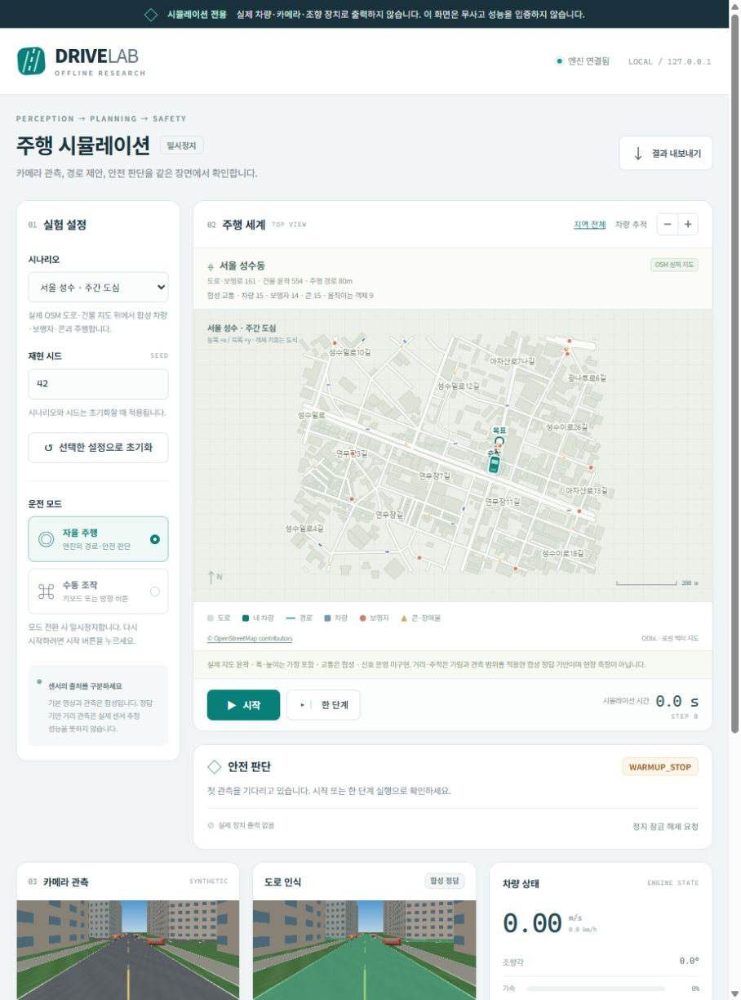
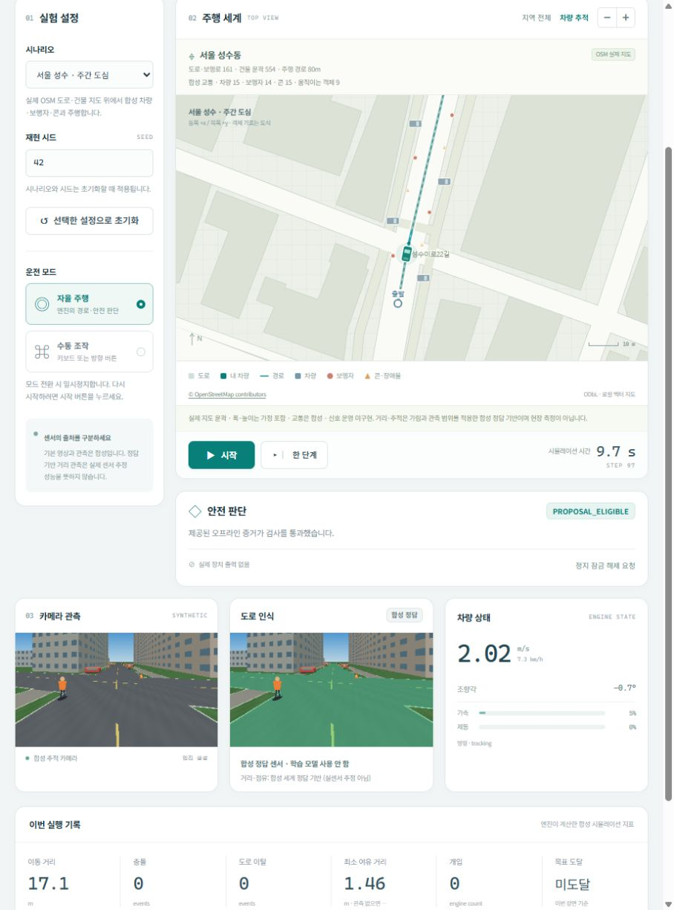
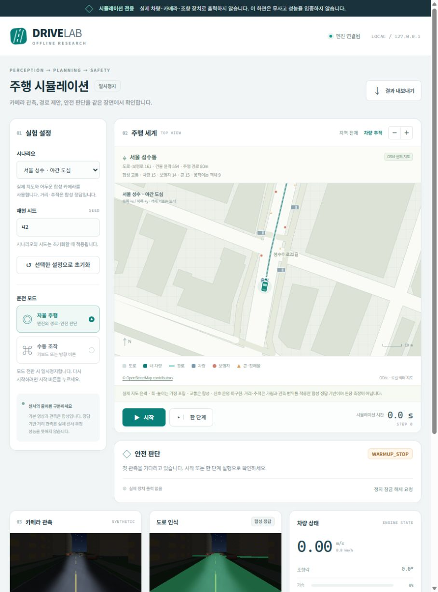

# 서울 성수동 지도 기반 시뮬레이션

Drive Lab에 **서울 성수동의 실제 공개 도로·건물 배치**를 반영한 지역을 추가했습니다. 직접 그린 단일 코스를 넘어 교차도로, 골목, 건물과 여러 이동·정지 물체가 있는 환경을 살펴볼 수 있습니다. 지도 형상은 OpenStreetMap 자료이며, 교통 참가자와 센서는 합성입니다. 실측 디지털 트윈이나 실제 서울의 교통 운영을 재현한 제품은 아닙니다.

## 실행과 화면

```bash
python -m pip install -e .
python -m camera_rc.simulator serve --scenario seoul_day --port 8766 --output runs/seoul-demo-001
```

[http://127.0.0.1:8766/](http://127.0.0.1:8766/)에서 시작합니다. 초기에는 정지 상태입니다. **전체 보기**로 지역 도로망·건물·장애물 배치를 보고, **차량 추적**과 확대/축소로 주변 장면을 살펴보세요. 기존 기본 코스도 시나리오 선택에 남아 있습니다. 시나리오를 바꾼 후에는 **선택한 설정으로 초기화**를 눌러 적용합니다.

수동 조작, 결과 저장, 학습 모델 연결, API와 서버 종료 방법은 [SIMULATOR](SIMULATOR.md)에 있습니다. 학습 모델을 연결하지 않은 기본 실행은 합성 정답 기반 센서를 사용합니다. 기존 모델 학습이나 취소한 속도 비교를 재개하지 않습니다.

## 무엇을 실제 지도에서 가져왔는가

| 항목 | 포함 내용 |
|---|---|
| 지역 | 서울 성수동, 위도 37.5415–37.5485 / 경도 127.0500–127.0610 |
| 지역 크기 | 로컬 투영 기준 약 970m × 778m |
| 도로·보행로·자전거도로 | OSM way 161개를 경계에 맞춰 선분 절단; 개별 도로 연결 형태 유지 |
| 건물 | 닫힌 OSM building way 554개의 윤곽; 복합 relation 건물은 이번 추출에 미포함 |
| 기준 주행 경로 | 성수이로 실제 중심선의 80m 구간; OSM way 519099440에서 추출 |
| 연결 도로 자료 | way 519099440과 519099441의 연속 중심선 약 473.55m; 자동 주행 시험 길이와 구분 |
| 지도 시점 | OSM 응답의 기준 시각 2026-10-23 10:26:41 UTC |
| 좌표 | 중심 위도 37.545 / 경도 127.0555 기준 local equirectangular, x 동쪽·y 북쪽, 미터 |

중심선에서 경로를 잘라낸 과정은 보간만 수행하며 도로를 새로 그리거나 실제 폭을 넓힌 것으로 표시하지 않습니다. 저장된 좌표의 소수점 자릿수는 **측량 정밀도**를 의미하지 않습니다. 이번 80m 기준 경로를 완주해도 서울 지역 전체의 교차로 운전을 검증한 것은 아닙니다.

원본 응답 SHA256: `13e32047b0389f1dd6c84c729baa8fd9ba51bbcccfa086363c867755c9b829cd`.

공개 데이터와 재현 규칙은 [지도 자료 설명](../src/camera_rc/simulator/assets/maps/README.md), [지도 데이터](../src/camera_rc/simulator/assets/maps/seoul_seongsu.json), [필요 필드만 남긴 원본 형상](../src/camera_rc/simulator/assets/maps/seoul_seongsu.source.json), [변환 코드](../src/camera_rc/simulator/region.py)에 있습니다. 출처의 질의·시점·해시와 지오메트리 해시는 데이터에 보존합니다. 서버는 실행 중 지도를 다운로드하지 않습니다.

## 지도 정보와 시뮬레이션 가정의 차이

- **도로 폭:** 이 스냅샷에는 명시적인 `width` 태그가 없습니다. 도로 분류별 가정값으로 표면을 만듭니다. 예를 들어 기준 성수이로는 반폭 5m를 사용합니다. 실제 차선 폭·차선 수·차량 통행 가능 여유를 측정한 값이 아닙니다.
- **건물 높이:** 227개는 OSM 높이 태그, 7개는 OSM 층수 × 가정 층고 3m, 나머지 320개는 9m 가정값입니다. 태그 자체도 현장 검증을 수행하지 않았습니다. 2D 충돌은 건물 윤곽을 사용합니다.
- **교통:** 차량·보행자·주차·콘의 위치, 속도와 등장 시점은 시드로 재현되는 가상 조건입니다. 실제 지역의 교통량이나 보행자 행동 자료가 아닙니다.
- **차선과 신호:** 기준 경로는 도로 중심선을 따라가는 연구용 제안입니다. 차선별 합법 주행, 일방통행 운용, 신호 현시·우선권·신호 위반 판정, 차선 변경과 교차로 협상은 구현하지 않았습니다. 실제 운전 안내로 사용하지 않습니다.
- **노면과 센서:** 경사, 마찰·타이어, 비·반사·렌즈 특성 및 실제 센서 노이즈는 모델링하지 않습니다. 야간은 합성 영상 조건이며 실제 야간 인식 성능 검증이 아닙니다.

## 확인된 실행 결과

시드 42, 고정 간격 0.1초, 기본 합성 정답 센서로 실행했습니다. 아래 시간은 **시뮬레이션 시간**이며 처리 속도 벤치마크가 아닙니다. 목표 판정은 경로 진행도·위치·방향·정지·차체 도로 포함과 이전 충돌/이탈 이력을 모두 검사합니다.

| 장면 | 객체 수 | 이동 거리 | 결과 | 충돌 / 이탈 |
|---|---:|---:|---|---:|
| 서울 주간 | 44 | 80.09m | 415단계, 41.5초에 80m 기준 경로 도달·정지 | 0 / 0 |
| 서울 야간 | 44 | 80.09m | 415단계, 41.5초에 기준 경로 도달·정지 | 0 / 0 |
| 경로 장애물 | 45 | 13.59m | 600단계까지 목표 미도달; 가려진 정지 경로의 미관측 셀 때문에 정지 잠금 | 0 / 0 |
| 수동 실패 재현 | 45 | 21.32m | 안전 제안을 따르지 않는 가상 전가속 입력, 41단계에서 접촉 검출 | 1 / 0 |

위험 장면은 우회 성공이 아니라 **미관측 공간을 통과하지 않고 멈춘 결과**입니다. 수동 실패 재현은 충돌 집계가 항상 0이 되는 잘못된 구현이 아님을 확인합니다. 서울 주간·야간의 동일 주행 결과는 학습 모델의 야간 인식 성능이 같다는 뜻이 아닙니다. 이상적인 가시 영역의 거리 정답을 사용했고 시야 범위만 주간 25m/야간 14m로 제한했습니다.





Windows 전체 검사는 **1,808개 통과·1개 생략·3개 차단 실패**입니다. 새 서울 검사 29개는 모두 통과했습니다. 실패 3개는 기존 런타임 통합 검사에서 실제 호스트 여유 RAM이 기본 1GiB 미만으로 내려가 안전 가드가 작동한 것입니다. 가드나 테스트를 낮추지 않았고 다른 앱도 종료하지 않았습니다. 공개 commit의 독립 Linux CPU 검사 상태는 [GitHub Actions](https://github.com/charater1024-lang/camera-rc-training/actions/workflows/cpu-tests.yml)에서 확인할 수 있습니다. 이 소프트웨어 검사는 정확도·실차 안전 검증이 아닙니다.

배포 wheel에 지도·화면 파일이 들어 있고, wheel에서 직접 지도 로드와 서울 엔진 한 단계 실행이 되는 것도 확인했습니다. 브라우저에서 전체 지도·차량 추적·확대/축소, 시작/정지와 낮/밤 초기화를 확인했습니다. 지도·소스 해시 및 실제 실행 지표는 [집계 JSON](../reports/simulator_seoul_validation.json)에 보존합니다.

## 검증 방법

지도형 환경에서는 정상 경로 도달, 혼잡 장애물 앞 정지, 센서 시야 가림, 도로 이탈과 건물 충돌을 구분해 확인합니다. **정지한 실행을 경로 완주로 집계하지 않습니다.** 충돌과 이탈은 의미 분할 마스크나 안전 모듈의 성공 표시와 별개인 세계 좌표 기하로 판정합니다.

시드, 시나리오, 모델 설정, 지도 해시와 단계별 기록을 함께 보존해야 재현할 수 있습니다. 시각적으로 장애물이 많아졌다는 사실만으로 평가 난도가 정량적으로 검증되거나 학습 모델이 향상된 것은 아닙니다. 서울 확장의 실제 실행 결과와 검사 범위는 [서울 검증 집계](../reports/simulator_seoul_validation.json)에 기록합니다.

추가로 필요한 것은 실제 차량 크기와 카메라 보정에 맞춘 센서 모델, 검증된 차선·신호·제한속도 지도, 교통 규칙과 상호작용 정책, 폐루프 장애물 회피 및 실제 센서/제동 오차입니다. 현재 결과로 실차 무사고, 실도로 운용 준비 또는 고속 주행 능력을 주장하지 않습니다.

## 라이선스

지도 자료: **© OpenStreetMap contributors**, [ODbL-1.0](https://opendatacommons.org/licenses/odbl/1-0/). [OSM 권리·출처 표시 안내](https://www.openstreetmap.org/copyright)에 따라 화면에 출처를 표시하고 변환 데이터도 동일 라이선스로 제공합니다. 지도 데이터는 프로젝트 코드의 AGPL-3.0-only 라이선스와 별개입니다. [THIRD_PARTY_NOTICES](../THIRD_PARTY_NOTICES.md)에서 공개 범위를 확인하세요.
