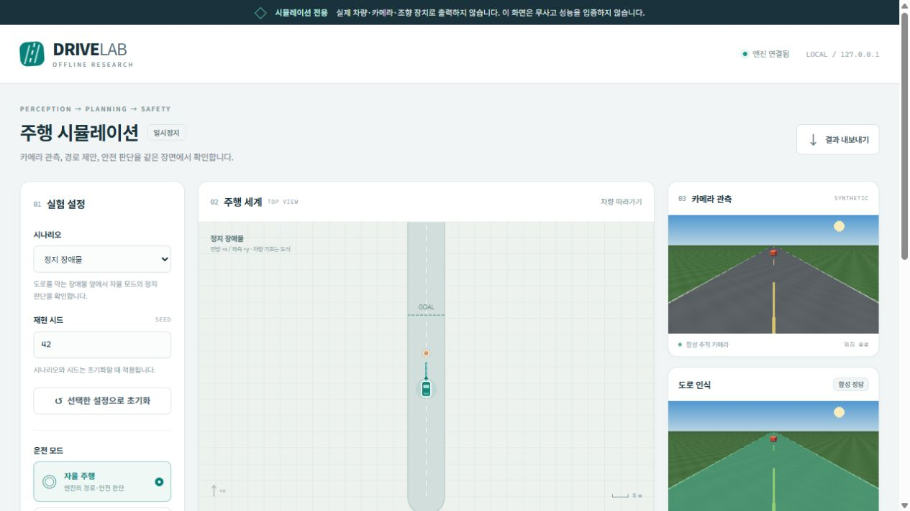

# 로컬 주행 시뮬레이터

브라우저에서 합성 도로를 주행하며 **카메라 영상 → 도로 인식 → 경로 제안 → 안전 거부 → 차량 상태**를 관찰하는 연구 도구입니다. 자율 모드와 키보드 수동 모드를 제공하며, 실제 차량·serial·카메라 장치에 연결하지 않습니다. 시작하기 전에는 일시정지 상태입니다.

이 시뮬레이터는 실제 자율주행 시스템, 센서 검증, 인증, 충돌률 검증 또는 무사고 보장이 아닙니다. 도로와 장애물 위치를 아는 합성 환경에서 제어·안전 계약의 동작을 살펴보는 용도입니다. 기존 도로 인식 성능표와 [후보 모델 미채택 판단](RESULTS.md)은 바뀌지 않습니다. 이전 학습·반복 자동화·속도 벤치마크를 재개하지 않습니다.

## 서울 실제 지도 장면

[서울 성수동 확장](SEOUL_SIMULATOR.md)은 공개 OSM 도로·건물 형상에 합성 교통을 결합합니다. `--scenario seoul_day` / `seoul_night` / `seoul_hazard`로 선택하며, 화면의 전체 보기·차량 추적·확대/축소를 사용합니다. 기존 단순 코스와 지도 기반 장면의 검증 근거는 구분합니다. 실측 차선·신호 운영·교통량을 재현했다는 뜻은 아닙니다.

## 빠른 시작

새 부산·광주·순천·강원 산지 장면과 고도·경사의 출처는
[지역 테마 합성 코스](REGIONAL_TERRAINS.md)에 있습니다. 서울의 OSM 지도와
구분해 표시하며 실제 지역의 도로·고도 데이터는 사용하지 않았습니다.

저장소를 내려받은 뒤 Python 3.10 이상의 가상 환경을 사용합니다. 기본 실행은 CPU로 가능하며, 학습된 가중치를 내려받지 않아도 합성 정답 기반 모드를 사용할 수 있습니다.

```powershell
python -m pip install -e .
python -m camera_rc.simulator serve --port 8766 --output runs/simulator-demo-001
```

터미널을 유지한 상태에서 [http://127.0.0.1:8766/](http://127.0.0.1:8766/)를 엽니다. 서버는 로컬 loopback에만 연결합니다. 방화벽을 열거나 외부 서버에 배포할 필요가 없습니다. 화면의 **시작** 버튼을 누르기 전에는 자동 주행이 시작되지 않습니다.

`--output`에는 기존 결과와 구별되는 새 경로를 사용하세요. 서버를 끝낼 때는 실행한 터미널에서 `Ctrl+C`를 누릅니다. 이는 시뮬레이터 프로세스를 종료하는 동작이며 다른 작업을 종료하지 않습니다. 서버 실행 자체와 별개인 학습·다운로드·백그라운드 자동화를 만들지 않습니다.

브라우저 없이 제한된 합성 회귀를 실행하려면:

```powershell
python -m camera_rc.simulator evaluate --output runs/simulator-eval-001 --steps 600
```

평가는 엔진이 제공하는 내장 시나리오를 사용합니다. 출력은 합성 장면에서의 결과이며 실제 도로 성능이나 GPU 처리 속도 측정값으로 해석하면 안 됩니다. CLI의 정확한 옵션은 `python -m camera_rc.simulator serve --help` 및 `python -m camera_rc.simulator evaluate --help`에서도 확인할 수 있습니다.

## 화면 사용법

차로와 이동 교통의 테스트는 [차로 분리·교통 상호작용](TRAFFIC_AND_LANES.md)을 참고하세요. 새 시나리오는 자차/반대 차로, 차량 추종·신호 정지와 보행 횡단을 구분합니다. 실제 사회 행동 검증은 아닙니다.

[주변 객체 인지 표시](OBJECT_VISUALIZATION.md)에서 카메라 객체 표시 토글, 종류·거리·이동 속도와 관측 시점을 확인할 수 있습니다. 객체 탐지기는 미연결이며 현재 정보는 합성 정답입니다.

1. **시나리오와 시드 선택:** 왼쪽에서 장면을 고르고 시드를 입력한 다음 **선택한 설정으로 초기화**를 누릅니다. 실행 중인 장면은 선택 상자만 바꿔서는 변경되지 않습니다.
2. **운전 모드 선택:** 자율 모드는 엔진의 경로·안전 판단을 사용합니다. 수동 모드는 키보드 또는 방향 버튼으로 조작합니다. 모드 변경 시 일시정지하므로 시작 버튼을 다시 눌러야 합니다.
3. **시작 / 일시정지:** 엔진의 시간을 진행하거나 멈춥니다. 화면은 실행 중·일시정지·실행 종료 상태를 서버 응답에 따라 표시합니다.
4. **한 단계:** 일시정지 상태에서 엔진을 한 번만 진행합니다. 반복 실행하거나 자동 재시작하지 않습니다.
5. **안전 판단 확인:** 안전 상태와 거부 이유가 주행 세계 아래에 표시됩니다. **정지 잠금 해제 요청**은 명시적인 요청일 뿐, 장애물 제거·정지 상태·새 관측 등 엔진 조건을 무시하고 잠금을 푸는 기능이 아닙니다.
6. **결과 내보내기:** 현재 서버의 실행 보고서를 JSON으로 내려받습니다. 초기화 전 필요한 결과를 보존하세요.

### 수동 조작

| 입력 | 동작 |
|---|---|
| `W` / `↑` | 전진 가속 |
| `A` / `←` | 좌회전 |
| `D` / `→` | 우회전 |
| `S` / `↓` / `Space` | 제동 |
| 화면의 방향 버튼 | 누르는 동안 같은 명령; 터치·마우스 사용 가능 |

방향 버튼에 키보드 초점을 둔 경우 `Space` 또는 `Enter`를 누르는 동안 해당 버튼이 동작합니다. 설정 입력칸을 편집할 때는 운전 단축키를 받지 않습니다.

수동 명령은 키 또는 버튼을 누르는 동안 약 180ms 간격으로 갱신합니다. **조작 키/버튼 하나라도 놓으면 현재 누름 상태를 해제하고 가속 0·제동 1을 보냅니다.** 조합 조작 후에도 다시 가속하려면 키를 새로 누르세요. 창이 초점을 잃거나 다른 탭으로 전환되거나 일시정지·초기화·모드 변경 시에도 제동합니다. 서버도 조작 갱신이 0.75초 넘게 끊기면 제동하는 독립된 만료 규칙을 사용합니다. 브라우저가 정지·단절된 상황에서 마지막 키 입력을 계속 유효하다고 간주하지 않습니다.

`Space`가 시작 등의 일반 버튼에 초점이 있을 때는 브라우저의 기본 버튼 조작을 유지합니다. 수동 단축키 대신 화면 방향 버튼을 사용하는 경우에도 동일한 제동 규칙이 적용됩니다. 현재 수동 모드는 후진 운전 실험을 제공하지 않습니다.

**수동 모드는 합성 실패 재현용 대조 조건입니다.** 안전 감독기의 판단은 계속 표시되지만 수동 명령으로 그 거부를 우회할 수 있어 충돌·도로 이탈을 재현할 수 있습니다. 화면에도 이 차이를 표시합니다. 자율 모드에서 허용된 운전 동작이나 실제 차량의 수동 인계 구현으로 해석하지 마세요.

## 화면의 값이 의미하는 것

차선 유지 비율·차체 여유·차선 이탈은 [합성 차선 유지 문서](LANE_KEEPING.md)의
가정 경계와 차체 둘레 검사에 근거합니다. 지도에는 가정 차선 경계도 표시하며,
자율주행 경로가 경계를 넘으면 별도 거부합니다. 차선 모델은 미학습 상태입니다.

| 화면 | 근거와 한계 |
|---|---|
| 주행 세계 | 합성 엔진의 정답 좌표. 기본 코스는 전방 `+x`, 좌측 `+y`, 서울 지도는 동쪽 `+x`, 북쪽 `+y`이며 단위는 미터입니다. 차량 기호는 위치·방향을 보여주는 도식이며 차체 실측 외곽이 아닙니다. 작은 장애물은 보기 쉽게 최소 크기로 그려지므로 정량 거리는 엔진 지표를 사용하세요. |
| 합성 추적 카메라 | 차량 후륜축 기준 뒤쪽 6m, 높이 3m에서 바라보는 합성 투영 영상입니다. 실제 차체에 장착된 전방 카메라 캘리브레이션이 아닙니다. |
| 도로 인식 | 엔진이 생성한 합성 정답 또는 선택한 학습 모델의 의미 분할 결과입니다. 이미지와 모델 종류·설명은 실제 엔진 응답을 표시합니다. |
| 거리·점유·추적 | 현재 엔진에서는 합성 세계의 정답을 사용합니다. 서울 장면은 이상화된 360도 거리 관측에 주간 25m/야간 14m 범위와 건물·물체 가림을 적용하고, 보이지 않는 트랙을 제외합니다. 학습 모델을 선택해도 실제 거리 센서·객체 추적 성능 검증이 되지 않습니다. |
| 차량 상태 | 엔진의 속도·조향각 및 실제 적용한 가속/제동 명령입니다. 실차 계기나 실제 모터 출력이 아닙니다. |
| 실행 기록 | 이동 거리, 충돌 이벤트, 도로 이탈 이벤트, 최소 여유 거리, 엔진 개입 횟수, 목표 도달 여부입니다. 이벤트 횟수를 영상 프레임 수나 실제 사고 건수로 바꾸어 해석하지 않습니다. |
| 안전 판단 | 입력 계약에 따른 오프라인 판단입니다. `proposal_eligible`이 참이어도 `actuation_enabled`는 거짓입니다. 실제 출력 권한이 생기지 않습니다. |

계산되지 않았거나 관측 근거가 없는 값은 `—`로 표시합니다. 표시를 채우기 위한 임의 실시간 값·성능 그래프는 없습니다. 카메라·인식 이미지는 실제 엔진 프레임 endpoint에서 받으며, 화면의 상태와 이미지 요청은 비동기입니다. 화면 갱신 시점이 모두 같은 물리 시각의 원자적 캡처임을 보장하지 않으므로 정밀 비교에는 저장된 실행 보고서와 별도의 고정 입력 평가를 사용하세요.

엔진은 제한된 wall-clock 속도로 시뮬레이션을 진행하고 UI는 약 250ms마다 상태를 받습니다. **시뮬레이션 시간은 실제 경과 시간, 추론 지연, FPS 또는 속도 벤치마크가 아닙니다.** 연결 오류가 생기면 화면에 오류와 마지막 수신 상태임을 표시하며, 새 주행을 자동 시작하지 않습니다.

## 자율주행 성능 패널

화면 상단의 **성능 지표 보기**를 누르면 경로 진행률, 경로·속도 RMSE,
방향 MAE, 자율 시간·거리, 평균/최고 속도, 안전 제안 통과 비율·거부 시간과
최근 시계열 그래프를 확인할 수 있습니다. 수동 구간은 자율 통계에서
제외하고 혼합 실행을 표시합니다. `performance` 통계는 상태·결과 JSON과
실행 로그에도 포함됩니다. [정확한 계산 기준과 범위](PERFORMANCE_METRICS.md)를
확인하세요. 진행률 100%와 목표 도달 판정은 구분하며 임의의 종합 안전
점수나 실제 사고율은 계산하지 않습니다.

## 속도 설정과 지역 지형

화면의 **조향·주행 모드**와 **속도 조절 방식**은 독립 설정입니다.
속도 상한 입력·슬라이더는 0–150km/h이며 **속도 설정 적용**을 눌러야
엔진에 반영됩니다. 입력 중인 값은 상태 갱신으로 덮어쓰지 않습니다.
주행 중에도 적용할 수 있고 0을 적용하면 물리 제동으로 정지합니다.

- **자동 속도 조절:** 요청한 상한 안에서 가정 권장 속도(부산 90,
  광주 150, 순천 100, 강원 산지 70km/h), 현재·앞쪽 곡선,
  정지 가능한 관측 거리와 목표까지의 거리로 속도를 낮춥니다.
- **사용자 지정 속도:** 권장 속도 대신 사용자가 상한을 정합니다.
  자율 주행에서는 곡률·관측·목표 거리 제한과 독립 안전 거부가 유지됩니다.
- **수동 조작:** 위 속도 설정은 가속 상한입니다. WASD/버튼을 눌러야
  가속하며, 기존 키 놓기·창 이탈·명령 만료 제동은 그대로 작동합니다.
  수동 모드의 합성 안전 우회 대조 조건도 유지합니다.

CLI 예시:

```powershell
python -m camera_rc.simulator serve --scenario gwangju_day --speed-mode automatic --target-speed-kmh 150 --port 8766 --output runs/gwangju-demo-001
python -m camera_rc.simulator evaluate --scenario gangwon_day --speed-mode user --target-speed-kmh 60 --steps 6000 --output runs/gangwon-eval-001
```

기존 기본 코스의 초기 자율 목표는 7.2km/h로 유지하며, 기본 수동 상한은
28.8km/h입니다. 새 지역 코스의 기본 상한은 150km/h입니다. 명시적으로
적용한 속도 설정은 시나리오 초기화 후에도 유지합니다. 새 코스는 최대
6,000단계(시뮬레이션 600초), 기존 코스는 기존 900단계 제한을 사용합니다.

새 지역의 기본 합성 모드는 가림을 적용한 이상적 400m 거리 관측과
직접 생성한 도로 정답을 사용합니다. 이 장거리 도로 근거는 학습 모델의
카메라 인식 성능이 아닙니다. 학습 모델 연결 시 해당 모드의 거리 관측은
25m로 제한되고 도로 확률도 학습 출력만 사용하며, 실패 시 정답 대체는
없습니다. 서울의 25m/14m 범위와 기본 코스의 근거리 관측도 유지합니다.

정지 경로 길이·미터 격자·예측 시간을 속도에 맞게 늘리지만, 격자의
0.3m 해상도와 독립 경로 표본 간격을 완화하지 않습니다. 이동량 0.04m
이하의 물리 서브스텝에서 충돌과 이탈을 검사하고 실제 속도는
150km/h로 제한합니다. 고속 설정의 가속·제동·저항과 고도 프로필의
종방향 중력은 합성 가정입니다. 카메라 투영과 충돌은 평면 기반이며
3D 노면·타이어·마찰·횡경사·현가장치는 재현하지 않습니다.

`POST /api/action`의 속도 변경 메시지는
`{"action":"speed","speed_mode":"user","target_speed_kmh":80}`입니다.
엔진 상태와 실행 보고서의 `speed_control`에는 요청값, 적용 모드,
현재 목표, 제한 근거를 기록합니다. `plan_world`는 화면·로그용으로 최대
약 257점으로 표시하며 독립 검증에는 더 촘촘한 경로를 사용합니다.

## 학습 모델을 연결하는 경우

이미 확보하고 검증한 로컬 `CameraPerception` 설정과 체크포인트가 있는 경우에만 선택적으로 연결합니다. 모델 가중치·학습/검증 영상 데이터는 이 저장소와 함께 배포하지 않습니다. 서울 지도 형상은 별도로 출처를 표시한 ODbL 자료입니다.

다음 JSON은 로컬에 만드는 **형식 예시**입니다. 경로는 JSON 파일이 있는 폴더를 기준으로 해석합니다. 없는 파일을 자동 취득하지 않습니다. 기본 합성 모드에는 모델 설정이나 `runtime`/`semantic` 추가 의존성이 필요하지 않습니다.

### Native 분할 체크포인트

예를 들어 `configs/local/simulator-native.json`을 다음과 같이 만듭니다. `segmentation_checkpoint`는 이 저장소의 native segmentation 형식으로 저장된 신뢰할 수 있는 로컬 파일이어야 합니다. 입력 크기와 모델 구조는 체크포인트 설정에서 읽으므로 YOLO 전용 입력 크기 필드를 넣지 않습니다.

```json
{
  "perception": {
    "segmentation_backend": "native",
    "segmentation_checkpoint": "../../models/native/best.pt",
    "drivable_class_ids": [0],
    "min_probability": 0.65,
    "half": false,
    "allow_diagnostic": false
  }
}
```

`drivable_class_ids`는 해당 모델의 실제 클래스 매핑에서 도로를 나타내는 ID여야 합니다. 위 `[0]`을 다른 클래스 매핑 모델에 그대로 사용하지 마세요.

### 검증된 YOLO26x 의미 분할 체크포인트

Ultralytics 의미 분할 지원이 필요한 경우 추가 의존성을 설치합니다. 이 저장소에서 검증한 semantic 버전은 `8.4.182`로 고정돼 있습니다. `constraints/semantic-cu126.txt`는 이전 Windows CUDA 실험 프로필이므로 CPU 데모를 위해 그대로 적용할 필요가 없습니다.

```powershell
python -m pip install -e ".[semantic]"
```

예를 들어 `configs/local/simulator-yolo.json`에 아래 형식을 사용합니다. `<검증한 보고서의 64자리 소문자 SHA256>`은 설명용 자리표시자이며 실행 가능한 해시가 아닙니다. 신뢰할 수 있는 완료 학습 보고서의 실제 해시로 교체해야 합니다.

```json
{
  "perception": {
    "segmentation_backend": "yolo26x_semantic",
    "segmentation_checkpoint": "../../models/yolo26x-sem/best.pt",
    "segmentation_training_report": "../../models/yolo26x-sem/training_report.json",
    "segmentation_training_report_sha256": "<검증한 보고서의 64자리 소문자 SHA256>",
    "segmentation_checkpoint_role": "best",
    "segmentation_input_size": [384, 640],
    "drivable_class_ids": [0],
    "min_probability": 0.65,
    "half": false,
    "allow_diagnostic": false
  }
}
```

PowerShell에서 보고서의 바이트 해시를 확인하는 예시:

```powershell
(Get-FileHash -LiteralPath models/yolo26x-sem/training_report.json -Algorithm SHA256).Hash.ToLowerInvariant()
```

해시를 계산했다는 사실만으로 외부 보고서나 가중치가 신뢰할 수 있게 되는 것은 아닙니다. 신뢰할 수 있는 로컬 학습 출처에서 확보한 파일만 사용하세요. 어댑터는 보고서의 완료 상태, 모델 종류·클래스, 학습 기록, 선택한 `best` 체크포인트의 SHA256·바이트 수를 검사합니다. 기존 출처 보고서를 새 경로에 맞추려고 수정하지 않습니다. 실제 학습 데이터 전체를 다시 검사하거나 출처의 정확성을 인증하는 절차는 아닙니다.

`segmentation_input_size`는 `[높이, 너비]`이며 위 예시는 384×640 FP32, 도로 확률 임계값 0.65입니다. 합성 화면에서 좋아 보이는 값으로 공식 평가 임계값을 다시 튜닝하지 않습니다. 모델 오류 시 정상 합성 인식인 것처럼 바꿔 계속 실행하지 않으며, 오류·정지 상태를 확인해야 합니다.

```powershell
python -m camera_rc.simulator serve --port 8766 --output runs/simulator-learned-001 --perception-config configs/local/your-perception.json --device cpu
```

이 모드는 **의미 분할 전용**입니다. 시뮬레이터용 설정에서는 `detection_checkpoint`를 제거해야 하며 이 키를 지정하면 CLI가 거부합니다. 평가에 사용하지 않는 객체 검출기를 불필요하게 로딩하거나 추론하지 않습니다. 의미 분할 결과는 안전 경로 영역의 비도로 거부에 실제로 영향을 줍니다. 그러나 경로의 기반 도로 형상과 미터 거리·점유·추적은 여전히 합성 정답에 의존하므로, 전체 자율주행을 학습 모델만으로 수행했다는 뜻이 아닙니다.

학습 모델은 합성 추적 카메라 영상에서 동작합니다. 기존 실제 영상 평가와 촬영 시점·질감·조명·카메라 보정이 다르므로 여기의 거부율이나 충돌 이벤트를 모델의 실제 도로 정확도 개선으로 보고하지 않습니다. 기본 합성 정답 모드는 센서/모델 오차가 없는 요소를 포함하므로 학습 모델보다 유리한 조건입니다. 둘을 동등한 실제 인식 성능 비교로 해석하면 안 됩니다. 모델 오류는 화면에서 확인하고 실행 보고서의 출처를 함께 보존하세요.

기존 공식 평가셋·공개 장애물 40장을 이 화면에서 튜닝하거나 새 학습 정답으로 사용하지 않습니다. 시뮬레이터를 조작해도 기존 모델 가중치, 학습 집합, 보고 계약, 운용 모델은 변경되지 않습니다.

## 저장되는 결과와 초기화

`serve`의 출력 예시는 다음과 같습니다.

```text
runs/simulator-demo-001/
  session_0000/
    configuration.json
    steps.jsonl
    summary.json
  session_0001/
    configuration.json
    steps.jsonl
    summary.json
```

- `configuration.json`: 해당 실행을 시작한 시나리오·시드·모드, 고정 시간 간격, 차체/도로/제동 가정, 합성 추적 카메라 구조, 선택 모델의 식별 근거입니다. 모드 전환 이후 상태는 단계별 기록도 함께 확인합니다.
- `steps.jsonl`: 실제로 수행한 각 시뮬레이션 단계의 상태를 한 줄씩 보존합니다. 서울의 고정 지도 전체는 `configuration.json`의 `map_region`에 한 번 저장하고 단계에는 지도 ID·기하 해시·해당 파일 참조를 남깁니다. 아직 한 단계도 실행하지 않았다면 파일이 없을 수 있습니다. 화면의 제한된 최근 이벤트 목록과 별개입니다.
- `summary.json`: 초기화로 이전 실행을 끝내거나 서버/평가가 정상 종료될 때 보존하는 실행 보고서입니다. 실행 중에는 아직 없을 수 있으며, 강제 프로세스 종료 시 완성되지 않을 수 있습니다. 이때 완료로 간주하지 않고 남은 `configuration.json`과 `steps.jsonl`을 확인합니다.

화면의 **초기화**는 이전 실행의 요약을 `end_reason: reset`으로 보존하고 다음 `session_XXXX` 폴더를 만듭니다. 번호는 `session_0000`부터 시작하며 이전 폴더를 삭제하거나 덮어쓰지 않습니다. 서버 자체를 다시 실행할 때는 기존 `--output`을 재사용하지 않고 새 출력 폴더를 지정합니다. 화면의 SESSION은 초기화할 때마다 새로 발급되는 UUID이며, 디스크의 순차적인 실행 폴더 번호와 다른 식별자입니다.

`evaluate`는 각 시나리오 아래 실행 폴더를 보존하고 최상위에 `suite.json`을 씁니다.

```text
runs/simulator-eval-001/
  clear/session_0000/...
  curved/session_0000/...
  ...
  suite.json
```

`suite.json`에는 요청한 단계 수, 시드, 합성/학습 인식 종류, 모델 식별 정보와 시나리오별 보고서가 들어갑니다. `--scenario`를 지정하면 그 시나리오만 평가합니다. 비교할 때는 시나리오, 시드, 고정 시간 간격, 실행 단계 수, 수동 입력 여부, 모델 출처·설정 및 합성 센서 가정이 같은지 확인하세요. 충돌 정답은 합성 세계의 기하학으로 검사하며 물리 접촉 이후의 충돌 반응·타이어·서스펜션까지 재현하지 않습니다.

브라우저 **결과 내보내기**는 요청 시점의 보고서를 다운로드하며 기존 디스크 결과를 덮어쓰지 않습니다. 공개 공유 전에는 로컬 설정·모델 출처에 개인 정보나 비공개 경로가 포함됐는지 별도로 확인하고 원본 가중치·데이터를 함께 배포하지 마세요.

## 공개 전 확인한 실행 결과

2026-10-23, seed 42, 고정 시간 간격 0.1초, 각 시나리오 최대 600단계의 **합성 정답 센서** 실행입니다. [원본 집계와 출처 SHA256](../reports/simulator_validation.json)을 함께 공개합니다.

| 시나리오 | 이동 거리 | 종료 상태 | 충돌 / 이탈 |
|---|---:|---|---:|
| 직선 | 36.68m | 목표 영역에서 정지 | 0 / 0 |
| 곡선 | 37.28m | 목표 영역에서 정지 | 0 / 0 |
| 정지 장애물 / 야간 장애물 | 각각 13.18m | 점유 영역 거부·정지 | 각각 0 / 0 |
| 횡단 보행자 | 8.90m | 위험 경로 거부·정지 | 0 / 0 |
| 제한된 가시거리 | 0m | 출발 전에 거부 | 0 / 0 |
| 카메라 고정 / 관측 손실 | 각각 3.93m | 관측 실패·정지 | 각각 0 / 0 |
| 제동 성능 저하 | 8.10m | 제동 계약 실패·정지 | 0 / 0 |

정지는 성공적인 경로 완주와 구분합니다. 위 장애물 시나리오는 장애물을 우회하는 경로 재탐색을 제공하지 않습니다. 멈춘 뒤 사람의 검토와 명시적 reset을 요구하는 보수적인 거부 동작입니다. **기본 데모에서 충돌이 없었다는 것이 실제 사고율 0%라는 뜻은 아닙니다.**

반대로 정지 장애물 시나리오에서 수동 입력으로 안전 거부를 우회해 75단계 가속한 음성 대조군은 **충돌 1건**을 기록했습니다. 충돌 판정은 안전 모듈이 출력한 이유가 아니라 세계 좌표의 차체·장애물 겹침을 검사합니다. 충돌 후 차량을 튕기거나 파손시키는 접촉 물리는 구현하지 않았습니다.

기존 **YOLO v2**의 완료 보고서·best 가중치를 검증하여 CPU FP32 384×640, 임계값 0.65로 합성 RGB 3장을 추론한 연결 검사도 수행했습니다. **추론 3/3 성공, 이동 0m, `semantic_disagreement_or_nonroad`로 거부**되었습니다. 이 가중치가 새로운 합성 시점에서도 잘 운전했다는 주장은 하지 않습니다. 원인 분해에는 합성 영상 도메인과 카메라 시점 차이, 보수적인 차체 경로 검사 범위 등을 별도로 검토해야 하며 현재 연결 검사만으로 원인을 확정할 수 없습니다. 정답 마스크로 바꿔 통과시키지 않았습니다.

전체 Windows CPU 소프트웨어 회귀는 **1,782개 통과·1개 생략**입니다. 그중 새 엔진 검사 31개와 서버/CLI 검사 31개는 이동·충돌·목표 영역·관측 실패·모델 오류·명령 만료·출처 및 로그 보존 등을 포함합니다. 브라우저에서 시작/정지/초기화/모드 전환/키보드 가속과 해제 제동/장애물 정지/영상 표시를 확인했고, wheel에 HTML·JS·CSS 세 자산이 포함되는 것도 확인했습니다. GitHub의 별도 Linux 결과는 해당 게시 commit의 Actions에서 확인합니다.



## 로컬 API와 실행 경계

| API | 용도 |
|---|---|
| `GET /api/state` | 현재 엔진 상태, 실행 여부, 시나리오, 오류, 세션 ID |
| `GET /api/scenarios` | 엔진이 제공하는 시나리오 목록 |
| `GET /frames/camera.png` | 합성 추적 카메라 프레임 |
| `GET /frames/segmentation.png` | 현재 의미 분할 표시 프레임 |
| `POST /api/action` | 시작, 일시정지, 한 단계, 초기화, 모드, 속도 설정, 수동 조작, 안전 reset 요청 |
| `GET /api/report` | 현재 실행 보고서 |

UI는 same-origin 요청만 보내며 POST에 `X-Simulator-Client: 1`을 사용합니다. 외부 CDN, 웹 폰트, 원격 분석 도구, 외부 이미지가 없습니다. UI에서 파일 경로나 학습 명령을 입력받지 않습니다. 이 로컬 앱을 인증된 다중 사용자 웹 서비스나 인터넷 공개 서버로 취급하지 마세요.

더 넓은 설계 목표와 미구현 실센서 생산자, 실제 차량 시험 전제는 [안전 아키텍처](SAFETY_ARCHITECTURE.md)에 정리돼 있습니다. 이 프로그램의 시각적 완성도와 합성 회귀 통과는 실제 차량의 제동 성능·센서 정확성·사고 방지 능력의 증거가 아닙니다.
