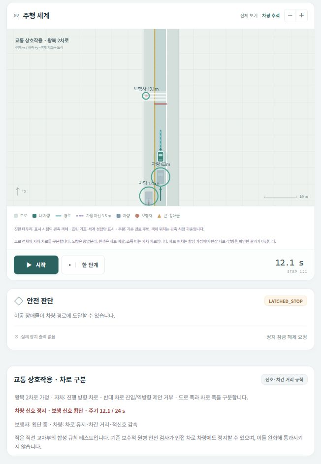
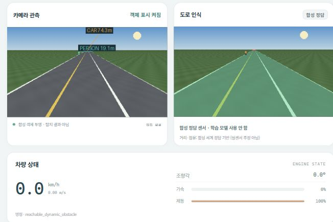

# 차로 분리와 교통 상호작용

## 기존 표시에서 확인한 문제

기존 도로 분할은 넓은 도로 영역이고, 자차 차선 검사는 기준 경로 주변의 폭 3.6m
가정 영역입니다. 도로 전체를 차선으로 허용한 것은 아니지만, 카메라의 기존
중앙선은 도로 중심에 그려져 검사 영역과 일치하지 않았고 차로의 진행 방향도
명시하지 않았습니다. 배경 차량·보행자는 대부분 정지 또는 짧은 왕복 움직임이었습니다.
이 상태를 실제 차로 인지·사회적 교통 행동 검증으로 해석할 수 없습니다.

## 차로·방향 구분

기준 경로를 자차의 `ego_forward` 차로 중심으로 지정하고 왼쪽에 반대 방향의
`opposing_reverse` 차로를 배치합니다. 자차 폭 3.6m, 반대 차로 폭 3.6m를 가정하며,
서울 경로는 가정 도로 폭 안에 배치하기 위해 반대 차로 폭 3.0m를 사용합니다.
이는 **현장 차로·진행 방향·통행 허가를 확인한 자료가 아닌 합성 배치**입니다.
남은 도로 면적은 차로가 아니라 여유 공간이며, 넓은 도로 마스크 자체가 주행 허가는 아닙니다.

카메라와 지도에 같은 배치로 중앙분리선(노랑), 차로 바깥 경계(흰색),
자차 차로 띠와 양방향 화살표를 표시합니다. 기준 경로가 도로 중앙선인 것처럼
그리던 기존 카메라 도색을 제거했습니다. 자차 차체·제안 경로의 차로 경계
검사는 유지하고, 기준 경로 접선과 반대 방향을 향하는 제안을
`wrong_way_veto`로 추가 거부합니다. 수동 모드의 실패 재현용 우회는 기존대로입니다.
실제 차선 인식 모델은 여전히 미학습입니다.

## 교통 상호작용 · 왕복 2차로

새 `traffic_interaction` 시나리오는 직선 횡단보도 하나에 다음 규칙을 적용합니다.

- 선행·후행 차량은 같은 방향 차로를 따라 이동하고, 앞 차량 및 자차와 차간 거리를 유지합니다.
- 반대 차량은 반대 차로를 따라 역방향으로 이동합니다. 순간 이동·주기적 위치 재설정을 하지 않습니다.
- 가속 1.5m/s²·감속 3m/s²로 제한하고 적신호 정지선 앞에서 감속합니다.
- 24초 주기에 차량 진행 0–8초, 전방향 정지 8–10초, 보행 횡단 10–18초,
  정리 시간 18–24초를 둡니다. 보행자가 이미 도로에 들어섰다면 횡단을 마칩니다.
- 보행자는 신호를 기다리고, 횡단 구역에 차량이 남아 있으면 진입을 기다립니다.
  속도·가속을 제한해 건너편까지 연속적으로 이동하고 도착 후 유지합니다.
- 자차는 적신호 제동을 추가로 적용합니다. 정지선을 이미 조금 넘은 상태라도
  교차부를 완전히 빠져나가기 전까지 제동을 해제하지 않습니다.
- 자율 모드의 이 시나리오 속도 제안은 최대 6m/s입니다. 사용자 150km/h 상한을
  지정해도 이 낮은 코스 제한과 안전 거부가 우선합니다.

물리 서브스텝마다 교통 상태를 진행하며 영상·객체 관측·충돌 검사가 같은
상태를 사용합니다. 조회만으로 교통 시간이 진행되지 않습니다.
NPC 간 접촉 이벤트도 별도로 집계합니다. 차량의 실제 접촉은 이 시나리오에 한해
가정 사각형 SAT 검사로, 보행자는 사각형-원 검사로 확인합니다. 이는 인접 차로의
정상적인 차체 간격을 큰 원형 차체의 충돌로 오판하지 않기 위한 접촉 모델 구분입니다.
SAT의 양수 분리 값은 정확한 유클리드 최소 거리 대신 분리 거리의 하한입니다.

**기존 안전 감독기의 큰 원형 차체·불확실성 검사는 그대로 유지합니다.**
그래서 인접 차로 차량에도 보수적으로 정지·잠금될 수 있습니다. 이를 줄여
시험을 통과시키거나 정상적인 실차 교통 대응이 완성되었다고 주장하지 않습니다.
정지 후 잠금이 걸렸다면 기존의 정상 관측·정지 상태·명시적 해제 조건을 따릅니다.

새 시나리오는 한정된 규칙 fixture입니다. 전체 도심 교통, 차로 변경, 끼어들기,
회전, 운전자·보행자 행동 분포를 재현하거나 실차 안전성을 검증한 모델이 아닙니다.
기존 서울·지역 시나리오의 배경 움직임은 비교를 위해 유지하고 화면에서
기존 단순 배경과 새 상호작용 시나리오를 구분합니다.

## 기록과 검사

`world.road_lanes`에 차로 ID·폭·진행 방향·중앙분리선과 경계,
`world.traffic`에 신호·횡단보도·보행 상태·NPC 접촉 횟수를 저장합니다.
객체에도 `lane_id`를 제공하고 단계 로그와 내보내기에 보존합니다.
기존 검증 보고서는 당시 소스의 기록으로 유지합니다.

`tests/test_simulator_traffic.py`는 도로 안 차로 침범, 차로 안 역주행,
방향별 연속 이동, 후행 차량 정지, 적신호 감속, 보행 대기·횡단,
NPC 접촉, 자차 신호 제동, 초기화와 시간 동기화를 검사합니다.

## 실행 확인

seed 42, 260단계·시뮬레이션 26초의 부분 실행에서 자차 차로 유지 100%,
자차 충돌·도로 이탈·NPC 간 접촉 0건과 보행자 횡단 완료를 확인했습니다.
자차는 기존 안전 계층에 의해 한 번 정지·잠금됐으며 목표 완주는 아닙니다.
기존 원형 불확실성 검사의 인접 교통에 대한 보수성을 그대로 드러내는 결과입니다.

[검사 집계와 소스 해시](../reports/simulator_traffic_lane_validation.json)를 보존합니다.

